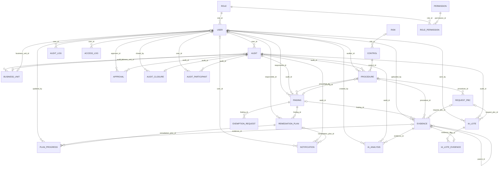
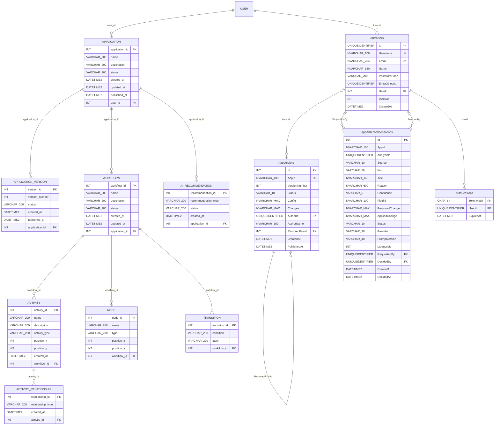
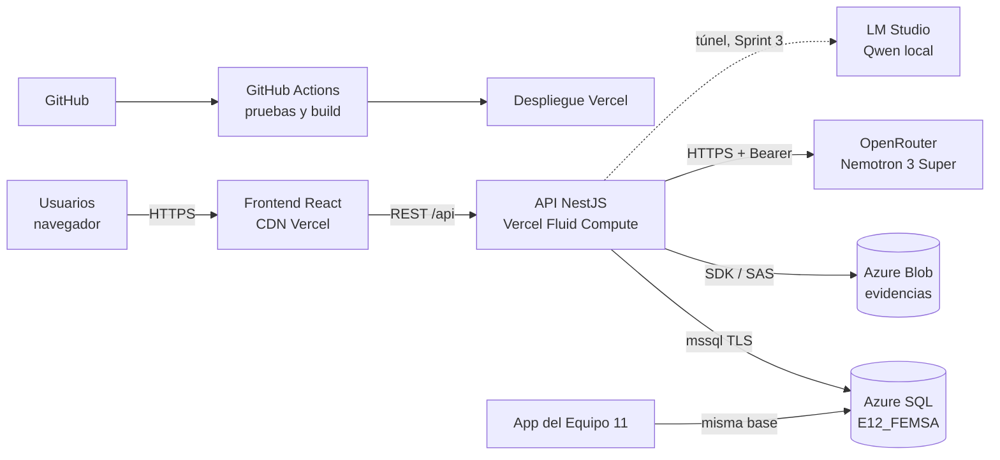
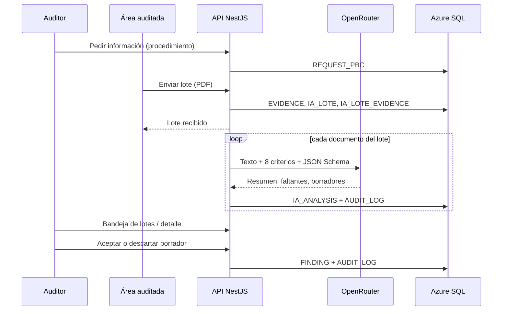

# Proyecto integrador · Base de datos y arquitectura

> **Nota (2026-11-10):** documento entregado por el Equipo 2 y copiado a este repo como referencia. Los scripts que aquí aparecen en `backend/src/datos/sql/scripts/` y en `auditoria_bd` ahora viven en [`db/base/`](../../db/base/) y [`db/migrations/`](../../db/migrations/README.md). Las decisiones vigentes de la integración están en [docs/decisiones](../decisiones/README.md).

**Equipo 12 · MesaPara7** · Sistema de Auditoría Interna FEMSA · Base compartida con el **Equipo 11 (Maple)** · Azure SQL `E12_FEMSA` (esquema `dbo`)

> Todo lo que sigue se generó leyendo la estructura real de la base en Azure SQL (columnas, tipos, PK, FK, UNIQUE, CHECK y valores por defecto).

## Contenido

1. [Diagrama entidad-relación](#1-diagrama-entidad-relación)
2. [Scripts de Azure SQL para crear la base](#2-scripts-de-azure-sql-para-crear-la-base)
3. [Diccionario de datos](#3-diccionario-de-datos)
4. [Arquitectura general del sistema e IA](#4-arquitectura-general-del-sistema-e-ia)
5. [Integración entre ambos equipos](#5-herramientas-metodología-y-pasos-para-integrar-el-proyecto-entre-ambos-equipos)

## 1. Diagrama entidad-relación

### 1.1 Criterio de clasificación

| Origen | Qué significa | Tablas |
|---|---|---|
| **Socio formador** | Entidad que viene del modelo de Archer IRM que entregó FEMSA (consolidado 2026Q1 y matriz CRUD). | AUDIT, BUSINESS_UNIT, CONTROL, RISK, PROCEDURE, REQUEST_PBC, EVIDENCE, FINDING, REMEDIATION_PLAN, EXEMPTION_REQUEST, RISK_LIBRARY, RISK_EVALUATION |
| **Compartida** | Seguridad común a los dos equipos (script `tablas_compartidas.sql`). | ROLE, USER, PERMISSION, ROLE_PERMISSION |
| **Equipo 12** | Diseñada por nuestro equipo para ejecución, cierre, seguimiento, bitácora e IA. | APPROVAL, AUDIT_CLOSURE, PLAN_PROGRESS, NOTIFICATION, AUDIT_PARTICIPANT, AUDIT_LOG, ACCESS_LOG, IA_ANALYSIS, IA_LOTE, IA_LOTE_EVIDENCE |
| **Equipo 11** | Diseñada por el Equipo 11 (Application Builder, Workflow Modeler, IA de configuración). | APPLICATION, APPLICATION_VERSION, WORKFLOW, ACTIVITY, ACTIVITY_RELATIONSHIP, NODE, TRANSITION, AI_RECOMMENDATION, AppVersions, AppAiRecommendations, AuthUsers, AuthSessions |
| **Auxiliar** | Apoyo para datos de prueba. | RISK_EVALUATION_DEMO_SEED |

### 1.2 Diagrama general (socio formador + compartidas + Equipo 12)

Relaciones entre todas las tablas del dominio de auditoría. Notación: `||` uno obligatorio, `|o` cero o uno, `o{` cero o muchos.



### 1.3 Tablas diseñadas por el Equipo 12 (con PK, FK y cardinalidades)

```mermaid
erDiagram
    APPROVAL {
        INT approval_id PK
        VARCHAR_200 approval_level
        VARCHAR_200 decision
        INT audit_id FK
        INT sequence
        INT approver_id FK
        NVARCHAR_1000 comments
        DATETIME2 decided_at
        VARCHAR_64 time_zone
    }
    AUDIT_CLOSURE {
        INT audit_closure_id PK
        VARCHAR_200 integrity_hash
        BIT blocked
        INT audit_id FK,UK
        INT closed_by FK
        DATETIME2 sealed_at
        VARCHAR_20 algorithm
        NVARCHAR_MAX manifest
        VARCHAR_500 signature
    }
    PLAN_PROGRESS {
        INT plan_progress_id PK
        DATETIME2 progress_date
        INT remediation_plan_id FK
        INT progress_pct
        NVARCHAR_1000 comment
        INT evidence_id FK
        INT updated_by FK
        VARCHAR_64 time_zone
    }
    NOTIFICATION {
        INT notification_id PK
        VARCHAR_200 type
        INT remediation_plan_id FK
        INT user_id FK
        INT audit_id FK
        NVARCHAR_500 message
        VARCHAR_20 channel
        DATETIME2 scheduled_at
        DATETIME2 sent_at
        BIT is_read
    }
    AUDIT_PARTICIPANT {
        INT audit_id PK,FK
        INT user_id PK,FK
        VARCHAR_30 role_in_audit
    }
    AUDIT_LOG {
        INT audit_log_id PK
        VARCHAR_60 entity
        INT entity_id
        VARCHAR_40 tracking_id
        VARCHAR_30 action
        INT user_id FK
        NVARCHAR_MAX detail
        VARCHAR_64 ip
        VARCHAR_64 time_zone
        DATETIME2 created_at
    }
    ACCESS_LOG {
        INT access_log_id PK
        INT user_id FK
        VARCHAR_200 email
        VARCHAR_20 result
        VARCHAR_64 ip
        VARCHAR_300 user_agent
        VARCHAR_64 time_zone
        DATETIME2 created_at
    }
    IA_ANALYSIS {
        INT analysis_id PK
        INT audit_id FK
        INT evidence_id FK
        VARCHAR_40 batch
        NVARCHAR_MAX payload
        INT created_by FK
        DATETIME2 created_at
        DATETIME2 updated_at
    }
    IA_LOTE {
        INT lote_id PK
        VARCHAR_20 tracking_id UK
        INT audit_id FK
        INT request_pbc_id FK
        INT sent_by FK
        NVARCHAR_300 subject
        VARCHAR_20 state
        INT total_docs
        INT analyzed_docs
        NVARCHAR_500 error
        DATETIME2 created_at
        DATETIME2 started_at
        DATETIME2 finished_at
    }
    IA_LOTE_EVIDENCE {
        INT lote_id PK,FK
        INT evidence_id PK,FK
    }
    AUDIT {
        INT audit_id PK
        VARCHAR_200 tracking_id UK
        VARCHAR_200 state
        INT user_id FK
        NVARCHAR_200 name
        NVARCHAR_1000 objective
        INT business_unit_id FK
        VARCHAR_40 audit_type
        NVARCHAR_100 area
        VARCHAR_10 priority
        DATE start_date
        DATE end_date
        DATETIME2 created_at
    }
    EVIDENCE {
        INT evidence_id PK
        VARCHAR_1000 blob_url
        INT procedure_id FK
        INT finding_id FK
        VARCHAR_40 tracking_id
        INT parent_id FK
        INT request_pbc_id FK
        NVARCHAR_260 file_name
        VARCHAR_150 mime_type
        BIGINT size_bytes
        CHAR_64 sha256
        INT uploaded_by FK
        DATETIME2 uploaded_at
        BIT deleted
    }
    USER {
        INT user_id PK
        UNIQUEIDENTIFIER entra_id UK
        VARCHAR_200 email UK
        VARCHAR_200 full_name
        BIT is_active
        DATETIME2 created_at
        INT role_id FK
        VARCHAR_30 direction
        INT business_unit_id FK
        VARCHAR_64 time_zone
        VARCHAR_100 password_hash
    }
    REMEDIATION_PLAN {
        INT remediation_plan_id PK
        INT progress_pct
        VARCHAR_200 state
        INT finding_id FK
        VARCHAR_30 tracking_id
        NVARCHAR_1000 description
        INT responsible_id FK
        DATETIME2 due_date
        DECIMAL_18_2 amount_mxn
        DATETIME2 concluded_at
    }
    REQUEST_PBC {
        INT request_pbc_id PK
        VARCHAR_200 state
        INT procedure_id FK
    }
    USER |o--o{ APPROVAL : "approver_id"
    AUDIT ||--o{ APPROVAL : "audit_id"
    USER |o--o{ AUDIT_CLOSURE : "closed_by"
    AUDIT ||--|o AUDIT_CLOSURE : "audit_id"
    USER |o--o{ PLAN_PROGRESS : "updated_by"
    EVIDENCE |o--o{ PLAN_PROGRESS : "evidence_id"
    REMEDIATION_PLAN ||--o{ PLAN_PROGRESS : "remediation_plan_id"
    USER |o--o{ NOTIFICATION : "user_id"
    AUDIT |o--o{ NOTIFICATION : "audit_id"
    REMEDIATION_PLAN |o--o{ NOTIFICATION : "remediation_plan_id"
    USER ||--o{ AUDIT_PARTICIPANT : "user_id"
    AUDIT ||--o{ AUDIT_PARTICIPANT : "audit_id"
    USER |o--o{ AUDIT_LOG : "user_id"
    USER |o--o{ ACCESS_LOG : "user_id"
    USER ||--o{ IA_ANALYSIS : "created_by"
    AUDIT ||--o{ IA_ANALYSIS : "audit_id"
    EVIDENCE ||--o{ IA_ANALYSIS : "evidence_id"
    USER ||--o{ IA_LOTE : "sent_by"
    AUDIT ||--o{ IA_LOTE : "audit_id"
    REQUEST_PBC |o--o{ IA_LOTE : "request_pbc_id"
    IA_LOTE ||--o{ IA_LOTE_EVIDENCE : "lote_id"
    EVIDENCE ||--|o IA_LOTE_EVIDENCE : "evidence_id"
    USER ||--o{ AUDIT : "user_id"
    BUSINESS_UNIT |o--o{ AUDIT : "business_unit_id"
    USER |o--o{ EVIDENCE : "uploaded_by"
    FINDING |o--o{ EVIDENCE : "finding_id"
    PROCEDURE |o--o{ EVIDENCE : "procedure_id"
    REQUEST_PBC |o--o{ EVIDENCE : "request_pbc_id"
    EVIDENCE |o--o{ EVIDENCE : "parent_id"
    ROLE ||--o{ USER : "role_id"
    BUSINESS_UNIT |o--o{ USER : "business_unit_id"
    USER |o--o{ REMEDIATION_PLAN : "responsible_id"
    FINDING ||--o{ REMEDIATION_PLAN : "finding_id"
    PROCEDURE ||--o{ REQUEST_PBC : "procedure_id"
```



### 1.4 Tablas del Equipo 11



### 1.5 Resumen por tabla

| Tabla | Origen | Responsable en la BD | Llave primaria (PK) | Llaves foráneas (FK) | Cardinalidades | ¿Tabla puente? |
|---|---|---|---|---|---|---|
| `APPROVAL` | Equipo 12 | Equipo 12 | approval_id | approver_id → USER.user_id<br>audit_id → AUDIT.audit_id | USER 1 : N APPROVAL (opcional)<br>AUDIT 1 : N APPROVAL | No |
| `AUDIT_CLOSURE` | Equipo 12 | Equipo 12 | audit_closure_id | closed_by → USER.user_id<br>audit_id → AUDIT.audit_id | USER 1 : N AUDIT_CLOSURE (opcional)<br>AUDIT 1 : 0..1 AUDIT_CLOSURE | No |
| `PLAN_PROGRESS` | Equipo 12 | Equipo 12 | plan_progress_id | updated_by → USER.user_id<br>evidence_id → EVIDENCE.evidence_id<br>remediation_plan_id → REMEDIATION_PLAN.remediation_plan_id | USER 1 : N PLAN_PROGRESS (opcional)<br>EVIDENCE 1 : N PLAN_PROGRESS (opcional)<br>REMEDIATION_PLAN 1 : N PLAN_PROGRESS | No |
| `NOTIFICATION` | Equipo 12 | Equipo 12 | notification_id | user_id → USER.user_id<br>audit_id → AUDIT.audit_id<br>remediation_plan_id → REMEDIATION_PLAN.remediation_plan_id | USER 1 : N NOTIFICATION (opcional)<br>AUDIT 1 : N NOTIFICATION (opcional)<br>REMEDIATION_PLAN 1 : N NOTIFICATION (opcional) | No |
| `AUDIT_PARTICIPANT` | Equipo 12 | Equipo 12 | audit_id, user_id | user_id → USER.user_id<br>audit_id → AUDIT.audit_id | USER 1 : N AUDIT_PARTICIPANT<br>AUDIT 1 : N AUDIT_PARTICIPANT | Sí |
| `AUDIT_LOG` | Equipo 12 | Equipo 12 | audit_log_id | user_id → USER.user_id | USER 1 : N AUDIT_LOG (opcional) | No |
| `ACCESS_LOG` | Equipo 12 | Equipo 12 | access_log_id | user_id → USER.user_id | USER 1 : N ACCESS_LOG (opcional) | No |
| `IA_ANALYSIS` | Equipo 12 | Equipo 12 | analysis_id | created_by → USER.user_id<br>audit_id → AUDIT.audit_id<br>evidence_id → EVIDENCE.evidence_id | USER 1 : N IA_ANALYSIS<br>AUDIT 1 : N IA_ANALYSIS<br>EVIDENCE 1 : N IA_ANALYSIS | Asociativa |
| `IA_LOTE` | Equipo 12 | Equipo 12 | lote_id | sent_by → USER.user_id<br>audit_id → AUDIT.audit_id<br>request_pbc_id → REQUEST_PBC.request_pbc_id | USER 1 : N IA_LOTE<br>AUDIT 1 : N IA_LOTE<br>REQUEST_PBC 1 : N IA_LOTE (opcional) | No |
| `IA_LOTE_EVIDENCE` | Equipo 12 | Equipo 12 | lote_id, evidence_id | lote_id → IA_LOTE.lote_id<br>evidence_id → EVIDENCE.evidence_id | IA_LOTE 1 : N IA_LOTE_EVIDENCE<br>EVIDENCE 1 : 0..1 IA_LOTE_EVIDENCE | Sí |
| `AUDIT` | Socio formador (Audit Engagement) | Equipo 12 | audit_id | user_id → USER.user_id<br>business_unit_id → BUSINESS_UNIT.business_unit_id | USER 1 : N AUDIT<br>BUSINESS_UNIT 1 : N AUDIT (opcional) | No |
| `BUSINESS_UNIT` | Socio formador (Catalogs (unidades de negocio)) | Equipo 12 | business_unit_id | audit_id → AUDIT.audit_id | AUDIT 1 : N BUSINESS_UNIT (opcional) | No |
| `CONTROL` | Socio formador (Control Procedures) | Equipo 12 | control_id | risk_id → RISK.risk_id | RISK 1 : N CONTROL (opcional) | No |
| `RISK` | Socio formador (Risk Register) | Equipo 12 | risk_id | — | — | No |
| `PROCEDURE` | Socio formador (Audit Procedures) | Equipo 12 | procedure_id | auditor_id → USER.user_id<br>audit_id → AUDIT.audit_id<br>control_id → CONTROL.control_id<br>finding_id → FINDING.finding_id | USER 1 : N PROCEDURE (opcional)<br>AUDIT 1 : N PROCEDURE<br>CONTROL 1 : N PROCEDURE<br>FINDING 1 : N PROCEDURE (opcional) | No |
| `REQUEST_PBC` | Socio formador (PBC Documentation Requests) | Equipo 12 | request_pbc_id | procedure_id → PROCEDURE.procedure_id | PROCEDURE 1 : N REQUEST_PBC | No |
| `EVIDENCE` | Socio formador (Evidence Repository) | Equipo 12 | evidence_id | uploaded_by → USER.user_id<br>finding_id → FINDING.finding_id<br>procedure_id → PROCEDURE.procedure_id<br>request_pbc_id → REQUEST_PBC.request_pbc_id<br>parent_id → EVIDENCE.evidence_id | USER 1 : N EVIDENCE (opcional)<br>FINDING 1 : N EVIDENCE (opcional)<br>PROCEDURE 1 : N EVIDENCE (opcional)<br>REQUEST_PBC 1 : N EVIDENCE (opcional)<br>EVIDENCE 1 : N EVIDENCE (opcional) | No |
| `FINDING` | Socio formador (Findings) | Equipo 12 | finding_id | responsible_id → USER.user_id<br>audit_id → AUDIT.audit_id<br>procedure_id → PROCEDURE.procedure_id | USER 1 : N FINDING (opcional)<br>AUDIT 1 : N FINDING<br>PROCEDURE 1 : N FINDING (opcional) | No |
| `REMEDIATION_PLAN` | Socio formador (Remediation Plans) | Equipo 12 | remediation_plan_id | responsible_id → USER.user_id<br>finding_id → FINDING.finding_id | USER 1 : N REMEDIATION_PLAN (opcional)<br>FINDING 1 : N REMEDIATION_PLAN | No |
| `EXEMPTION_REQUEST` | Socio formador (Exception Requests) | Equipo 12 | exemption_request_id | finding_id → FINDING.finding_id | FINDING 1 : N EXEMPTION_REQUEST | No |
| `RISK_LIBRARY` | Socio formador (Risk Library) | Equipo 11 | risk_library_id | — | — | No |
| `RISK_EVALUATION` | Socio formador (Risk Hierarchy / evaluación) | Equipo 11 | evaluation_id | risk_library_id → RISK_LIBRARY.risk_library_id | RISK_LIBRARY 1 : N RISK_EVALUATION | No |
| `ROLE` | Compartida | Ambos equipos | role_id | — | — | No |
| `USER` | Compartida | Ambos equipos | user_id | role_id → ROLE.role_id<br>business_unit_id → BUSINESS_UNIT.business_unit_id | ROLE 1 : N USER<br>BUSINESS_UNIT 1 : N USER (opcional) | No |
| `PERMISSION` | Compartida | Ambos equipos | permission_id | — | — | No |
| `ROLE_PERMISSION` | Compartida | Ambos equipos | role_permission_id | role_id → ROLE.role_id<br>permission_id → PERMISSION.permission_id | ROLE 1 : N ROLE_PERMISSION<br>PERMISSION 1 : N ROLE_PERMISSION | Sí |
| `APPLICATION` | Equipo 11 | Equipo 11 | application_id | user_id → USER.user_id | USER 1 : N APPLICATION | No |
| `APPLICATION_VERSION` | Equipo 11 | Equipo 11 | version_id | application_id → APPLICATION.application_id | APPLICATION 1 : N APPLICATION_VERSION | No |
| `WORKFLOW` | Equipo 11 | Equipo 11 | workflow_id | application_id → APPLICATION.application_id | APPLICATION 1 : N WORKFLOW | No |
| `ACTIVITY` | Equipo 11 | Equipo 11 | activity_id | workflow_id → WORKFLOW.workflow_id | WORKFLOW 1 : N ACTIVITY | No |
| `ACTIVITY_RELATIONSHIP` | Equipo 11 | Equipo 11 | relationship_id | activity_id → ACTIVITY.activity_id | ACTIVITY 1 : N ACTIVITY_RELATIONSHIP | No |
| `NODE` | Equipo 11 | Equipo 11 | node_id | workflow_id → WORKFLOW.workflow_id | WORKFLOW 1 : N NODE | No |
| `TRANSITION` | Equipo 11 | Equipo 11 | transition_id | workflow_id → WORKFLOW.workflow_id | WORKFLOW 1 : N TRANSITION | No |
| `AI_RECOMMENDATION` | Equipo 11 | Equipo 11 | recommendation_id | application_id → APPLICATION.application_id | APPLICATION 1 : N AI_RECOMMENDATION | No |
| `AppVersions` | Equipo 11 | Equipo 11 | Id | RestoredFromId → AppVersions.Id<br>AuthorId → AuthUsers.Id | AppVersions 1 : N AppVersions (opcional)<br>AuthUsers 1 : N AppVersions (opcional) | No |
| `AppAiRecommendations` | Equipo 11 | Equipo 11 | Id | RequestedBy → AuthUsers.Id<br>DecidedBy → AuthUsers.Id | AuthUsers 1 : N AppAiRecommendations (opcional)<br>AuthUsers 1 : N AppAiRecommendations (opcional) | No |
| `AuthUsers` | Equipo 11 | Equipo 11 | Id | UserId → USER.user_id | USER 1 : N AuthUsers | No |
| `AuthSessions` | Equipo 11 | Equipo 11 | TokenHash | UserId → AuthUsers.Id | AuthUsers 1 : N AuthSessions | No |
| `RISK_EVALUATION_DEMO_SEED` | Auxiliar | Equipo 11 | evaluation_id | — | — | No |

**Tablas puente:** `AUDIT_PARTICIPANT` (AUDIT ↔ USER), `IA_LOTE_EVIDENCE` (IA_LOTE ↔ EVIDENCE) y `ROLE_PERMISSION` (ROLE ↔ PERMISSION). `IA_ANALYSIS` es una entidad asociativa entre AUDIT y EVIDENCE porque además guarda el resultado de la IA.

## 2. Scripts de Azure SQL para crear la base

Orden de ejecución. Los scripts 1 a 5 están en el repositorio compartido [hectorpablogzz/auditoria_bd](https://github.com/hectorpablogzz/auditoria_bd/tree/main/scripts); los de IA y contraseñas en `backend/src/datos/sql/scripts/` del repositorio del Equipo 12. Todos los del Equipo 12 se pueden correr más de una vez.

| # | Script | Qué crea |
|---|---|---|
| 1 | `tablas_compartidas.sql` | ROLE, USER, PERMISSION, ROLE_PERMISSION |
| 2 | `tablas_eq11.sql` | Tablas del Equipo 11 (Application Builder y Workflow Modeler) |
| 3 | `tablas_eq12.sql` | Tablas base del Equipo 12 (AUDIT, CONTROL, PROCEDURE, FINDING, EVIDENCE, planes, etc.) |
| 4 | `ampliacion_eq12.sql` | Columnas y tablas que usa la API del Equipo 12 (RISK, AUDIT_PARTICIPANT, AUDIT_LOG, ACCESS_LOG, catálogos) |
| 5 | `datos_prueba_usuarios_organizacion.sql` | Datos de prueba: usuarios, participantes y unidades de negocio |
| 6 | `ia_analysis.sql` | IA_ANALYSIS (resultados de la IA) |
| 7 | `ia_lote.sql` | IA_LOTE e IA_LOTE_EVIDENCE (lotes de evidencia) |
| 8 | `user_password.sql` | Columna password_hash en USER (bcrypt) |

### 2.1 `tablas_compartidas.sql`

```sql
--Tabla ROLE --
CREATE TABLE dbo.[ROLE]
(
    role_id INT IDENTITY(1,1) NOT NULL,
    name VARCHAR(200) NOT NULL,
    description VARCHAR(200) NOT NULL,

    CONSTRAINT PK_ROLE
        PRIMARY KEY (role_id)
);

--Tabla USER --
CREATE TABLE dbo.[USER]
(
    user_id INT IDENTITY(1,1) NOT NULL,
    entra_id UNIQUEIDENTIFIER NOT NULL,
    email VARCHAR(200) NOT NULL,
    full_name VARCHAR(200) NOT NULL,
    is_active BIT NOT NULL DEFAULT 1,
    created_at DATETIME2 NOT NULL DEFAULT SYSDATETIME(),
    role_id INT NOT NULL,

    CONSTRAINT PK_USER
        PRIMARY KEY (user_id),

    CONSTRAINT UQ_USER_ENTRA_ID
        UNIQUE (entra_id),

    CONSTRAINT UQ_USER_EMAIL
        UNIQUE (email),

    CONSTRAINT FK_USER_ROLE
        FOREIGN KEY (role_id)
        REFERENCES dbo.[ROLE](role_id)
);

--Tabla PERMISSION --
CREATE TABLE dbo.PERMISSION
(
    permission_id INT IDENTITY(1,1) NOT NULL,
    name VARCHAR(200) NOT NULL,
    description VARCHAR(200) NOT NULL,
    module VARCHAR(200) NOT NULL,

    CONSTRAINT PK_PERMISSION
        PRIMARY KEY (permission_id)
);

--Tabla ROLE_PERMISSION --
CREATE TABLE dbo.ROLE_PERMISSION
(
    role_permission_id INT IDENTITY(1,1) NOT NULL,
    role_id INT NOT NULL,
    permission_id INT NOT NULL,

    CONSTRAINT PK_ROLE_PERMISSION
        PRIMARY KEY (role_permission_id),

    CONSTRAINT UQ_ROLE_PERMISSION
        UNIQUE (role_id, permission_id),

    CONSTRAINT FK_ROLE_PERMISSION_ROLE
        FOREIGN KEY (role_id)
        REFERENCES dbo.[ROLE](role_id),

    CONSTRAINT FK_ROLE_PERMISSION_PERMISSION
        FOREIGN KEY (permission_id)
        REFERENCES dbo.PERMISSION(permission_id)
);
```

### 2.2 `tablas_eq11.sql`

```sql
--Tabla APPLICATION--
CREATE TABLE dbo.APPLICATION
(
    application_id INT IDENTITY(1,1) NOT NULL,
    name VARCHAR(200) NOT NULL,
    description VARCHAR(200) NOT NULL,
    status VARCHAR(200) NOT NULL,
    created_at DATETIME2 NOT NULL DEFAULT SYSDATETIME(),
    updated_at DATETIME2 NOT NULL DEFAULT SYSDATETIME(),
    published_at DATETIME2 NULL,
    user_id INT NOT NULL,

    CONSTRAINT PK_APPLICATION
        PRIMARY KEY (application_id),

    CONSTRAINT FK_APPLICATION_USER
        FOREIGN KEY (user_id)
        REFERENCES dbo.[USER](user_id)
);

--Tabla WORKFLOW--
CREATE TABLE dbo.WORKFLOW
(
    workflow_id INT IDENTITY(1,1) NOT NULL,
    name VARCHAR(200) NOT NULL,
    description VARCHAR(200) NOT NULL,
    status VARCHAR(200) NOT NULL,
    created_at DATETIME2 NOT NULL DEFAULT SYSDATETIME(),
    updated_at DATETIME2 NOT NULL DEFAULT SYSDATETIME(),
    application_id INT NOT NULL,

    CONSTRAINT PK_WORKFLOW
        PRIMARY KEY (workflow_id),

    CONSTRAINT FK_WORKFLOW_APPLICATION
        FOREIGN KEY (application_id)
        REFERENCES dbo.APPLICATION(application_id)
);

--Tabla ACTIVITY--
CREATE TABLE dbo.ACTIVITY
(
    activity_id INT IDENTITY(1,1) NOT NULL,
    name VARCHAR(200) NOT NULL,
    description VARCHAR(200) NOT NULL,
    activity_type VARCHAR(200) NOT NULL,
    position_x INT NOT NULL,
    position_y INT NOT NULL,
    created_at DATETIME2 NOT NULL DEFAULT SYSDATETIME(),
    workflow_id INT NOT NULL,

    CONSTRAINT PK_ACTIVITY
        PRIMARY KEY (activity_id),

    CONSTRAINT FK_ACTIVITY_WORKFLOW
        FOREIGN KEY (workflow_id)
        REFERENCES dbo.WORKFLOW(workflow_id)
);

--Tabla ACTIVITY_RELATIONSHIP--
CREATE TABLE dbo.ACTIVITY_RELATIONSHIP
(
    relationship_id INT IDENTITY(1,1) NOT NULL,
    relationship_type VARCHAR(200) NOT NULL,
    created_at DATETIME2 NOT NULL DEFAULT SYSDATETIME(),
    activity_id INT NOT NULL,

    CONSTRAINT PK_ACTIVITY_RELATIONSHIP
        PRIMARY KEY (relationship_id),

    CONSTRAINT FK_ACTIVITY_RELATIONSHIP_ACTIVITY
        FOREIGN KEY (activity_id)
        REFERENCES dbo.ACTIVITY(activity_id)
);

--Tabla APPLICATION_VERSION--
CREATE TABLE dbo.APPLICATION_VERSION
(
    version_id INT IDENTITY(1,1) NOT NULL,
    version_number INT NOT NULL,
    status VARCHAR(200) NOT NULL,
    created_at DATETIME2 NOT NULL DEFAULT SYSDATETIME(),
    published_at DATETIME2 NULL,
    application_id INT NOT NULL,

    CONSTRAINT PK_APPLICATION_VERSION
        PRIMARY KEY (version_id),

    CONSTRAINT FK_APPLICATION_VERSION_APPLICATION
        FOREIGN KEY (application_id)
        REFERENCES dbo.APPLICATION(application_id)
);

--AI_RECOMMENDATION--
CREATE TABLE dbo.AI_RECOMMENDATION
(
    recommendation_id INT IDENTITY(1,1) NOT NULL,
    recommendation_type VARCHAR(200) NOT NULL,
    status VARCHAR(200) NOT NULL,
    created_at DATETIME2 NOT NULL DEFAULT SYSDATETIME(),
    application_id INT NOT NULL,

    CONSTRAINT PK_AI_RECOMMENDATION
        PRIMARY KEY (recommendation_id),

    CONSTRAINT FK_AI_RECOMMENDATION_APPLICATION
        FOREIGN KEY (application_id)
        REFERENCES dbo.APPLICATION(application_id)
);

--Tabla NODE--
CREATE TABLE dbo.NODE
(
    node_id INT IDENTITY(1,1) NOT NULL,
    name VARCHAR(200) NOT NULL,
    type VARCHAR(200) NOT NULL,
    position_x INT NOT NULL,
    position_y INT NOT NULL,
    workflow_id INT NOT NULL,

    CONSTRAINT PK_NODE
        PRIMARY KEY (node_id),

    CONSTRAINT FK_NODE_WORKFLOW
        FOREIGN KEY (workflow_id)
        REFERENCES dbo.WORKFLOW(workflow_id)
);

--Tabla TRANSITION--
CREATE TABLE dbo.TRANSITION
(
    transition_id INT IDENTITY(1,1) NOT NULL,
    condition VARCHAR(200) NOT NULL,
    label VARCHAR(200) NOT NULL,
    workflow_id INT NOT NULL,

    CONSTRAINT PK_TRANSITION
        PRIMARY KEY (transition_id),

    CONSTRAINT FK_TRANSITION_WORKFLOW
        FOREIGN KEY (workflow_id)
        REFERENCES dbo.WORKFLOW(workflow_id)
);
```

### 2.3 `tablas_eq12.sql`

```sql
-- TABLAS DEL EQUIPO 12 (MesaPara7) --

--Tabla AUDIT--
CREATE TABLE dbo.AUDIT
(
    audit_id INT IDENTITY(1,1) NOT NULL,
    tracking_id VARCHAR(200) NOT NULL,
    state VARCHAR(200) NOT NULL,
    user_id INT NOT NULL,

    CONSTRAINT PK_AUDIT
        PRIMARY KEY (audit_id),

    CONSTRAINT FK_AUDIT_USER
        FOREIGN KEY (user_id)
        REFERENCES dbo.[USER](user_id)
);

--Tabla CONTROL--
CREATE TABLE dbo.CONTROL
(
    control_id INT IDENTITY(1,1) NOT NULL,
    tracking_id VARCHAR(200) NOT NULL,
    associated_risk VARCHAR(200) NOT NULL,

    CONSTRAINT PK_CONTROL
        PRIMARY KEY (control_id)
);

--Tabla BUSINESS_UNIT--
CREATE TABLE dbo.BUSINESS_UNIT
(
    business_unit_id INT IDENTITY(1,1) NOT NULL,
    unity VARCHAR(200) NOT NULL,
    country VARCHAR(200) NOT NULL,
    audit_id INT NOT NULL,

    CONSTRAINT PK_BUSINESS_UNIT
        PRIMARY KEY (business_unit_id),

    CONSTRAINT FK_BUSINESS_UNIT_AUDIT
        FOREIGN KEY (audit_id)
        REFERENCES dbo.AUDIT(audit_id)
);

--Tabla FINDING--
CREATE TABLE dbo.FINDING
(
    finding_id INT IDENTITY(1,1) NOT NULL,
    severity VARCHAR(200) NOT NULL,
    state VARCHAR(200) NOT NULL,
    audit_id INT NOT NULL,

    CONSTRAINT PK_FINDING
        PRIMARY KEY (finding_id),

    CONSTRAINT FK_FINDING_AUDIT
        FOREIGN KEY (audit_id)
        REFERENCES dbo.AUDIT(audit_id)
);

--Tabla PROCEDURE--
CREATE TABLE dbo.[PROCEDURE]
(
    procedure_id INT IDENTITY(1,1) NOT NULL,
    effectiveness_rating VARCHAR(200) NOT NULL,
    audit_id INT NOT NULL,
    control_id INT NOT NULL,
    finding_id INT NOT NULL,

    CONSTRAINT PK_PROCEDURE
        PRIMARY KEY (procedure_id),

    CONSTRAINT FK_PROCEDURE_AUDIT
        FOREIGN KEY (audit_id)
        REFERENCES dbo.AUDIT(audit_id),

    CONSTRAINT FK_PROCEDURE_CONTROL
        FOREIGN KEY (control_id)
        REFERENCES dbo.CONTROL(control_id),

    CONSTRAINT FK_PROCEDURE_FINDING
        FOREIGN KEY (finding_id)
        REFERENCES dbo.FINDING(finding_id)
);

--Tabla APPROVAL--
CREATE TABLE dbo.APPROVAL
(
    approval_id INT IDENTITY(1,1) NOT NULL,
    approval_level VARCHAR(200) NOT NULL,
    decision VARCHAR(200) NOT NULL,
    audit_id INT NOT NULL,

    CONSTRAINT PK_APPROVAL
        PRIMARY KEY (approval_id),

    CONSTRAINT FK_APPROVAL_AUDIT
        FOREIGN KEY (audit_id)
        REFERENCES dbo.AUDIT(audit_id)
);

--Tabla AUDIT_CLOSURE--
CREATE TABLE dbo.AUDIT_CLOSURE
(
    audit_closure_id INT IDENTITY(1,1) NOT NULL,
    integrity_hash VARCHAR(200) NOT NULL,
    blocked BIT NOT NULL DEFAULT 0,
    audit_id INT NOT NULL,

    CONSTRAINT PK_AUDIT_CLOSURE
        PRIMARY KEY (audit_closure_id),

    CONSTRAINT FK_AUDIT_CLOSURE_AUDIT
        FOREIGN KEY (audit_id)
        REFERENCES dbo.AUDIT(audit_id)
);

--Tabla REQUEST_PBC--
CREATE TABLE dbo.REQUEST_PBC
(
    request_pbc_id INT IDENTITY(1,1) NOT NULL,
    state VARCHAR(200) NOT NULL,
    procedure_id INT NOT NULL,

    CONSTRAINT PK_REQUEST_PBC
        PRIMARY KEY (request_pbc_id),

    CONSTRAINT FK_REQUEST_PBC_PROCEDURE
        FOREIGN KEY (procedure_id)
        REFERENCES dbo.[PROCEDURE](procedure_id)
);

--Tabla EVIDENCE--
CREATE TABLE dbo.EVIDENCE
(
    evidence_id INT IDENTITY(1,1) NOT NULL,
    blob_url VARCHAR(200) NOT NULL,
    procedure_id INT NOT NULL,
    finding_id INT NOT NULL,

    CONSTRAINT PK_EVIDENCE
        PRIMARY KEY (evidence_id),

    CONSTRAINT FK_EVIDENCE_PROCEDURE
        FOREIGN KEY (procedure_id)
        REFERENCES dbo.[PROCEDURE](procedure_id),

    CONSTRAINT FK_EVIDENCE_FINDING
        FOREIGN KEY (finding_id)
        REFERENCES dbo.FINDING(finding_id)
);

--Tabla EXEMPTION_REQUEST--
CREATE TABLE dbo.EXEMPTION_REQUEST
(
    exemption_request_id INT IDENTITY(1,1) NOT NULL,
    state VARCHAR(200) NOT NULL,
    finding_id INT NOT NULL,

    CONSTRAINT PK_EXEMPTION_REQUEST
        PRIMARY KEY (exemption_request_id),

    CONSTRAINT FK_EXEMPTION_REQUEST_FINDING
        FOREIGN KEY (finding_id)
        REFERENCES dbo.FINDING(finding_id)
);

--Tabla REMEDIATION_PLAN--
CREATE TABLE dbo.REMEDIATION_PLAN
(
    remediation_plan_id INT IDENTITY(1,1) NOT NULL,
    progress_pct INT NOT NULL DEFAULT 0,
    state VARCHAR(200) NOT NULL,
    finding_id INT NOT NULL,

    CONSTRAINT PK_REMEDIATION_PLAN
        PRIMARY KEY (remediation_plan_id),

    CONSTRAINT FK_REMEDIATION_PLAN_FINDING
        FOREIGN KEY (finding_id)
        REFERENCES dbo.FINDING(finding_id)
);

--Tabla PLAN_PROGRESS--
CREATE TABLE dbo.PLAN_PROGRESS
(
    plan_progress_id INT IDENTITY(1,1) NOT NULL,
    progress_date DATETIME2 NOT NULL DEFAULT SYSDATETIME(),
    remediation_plan_id INT NOT NULL,

    CONSTRAINT PK_PLAN_PROGRESS
        PRIMARY KEY (plan_progress_id),

    CONSTRAINT FK_PLAN_PROGRESS_REMEDIATION_PLAN
        FOREIGN KEY (remediation_plan_id)
        REFERENCES dbo.REMEDIATION_PLAN(remediation_plan_id)
);

--Tabla NOTIFICATION--
CREATE TABLE dbo.NOTIFICATION
(
    notification_id INT IDENTITY(1,1) NOT NULL,
    type VARCHAR(200) NOT NULL,
    remediation_plan_id INT NOT NULL,

    CONSTRAINT PK_NOTIFICATION
        PRIMARY KEY (notification_id),

    CONSTRAINT FK_NOTIFICATION_REMEDIATION_PLAN
        FOREIGN KEY (remediation_plan_id)
        REFERENCES dbo.REMEDIATION_PLAN(remediation_plan_id)
);
```

### 2.4 `ampliacion_eq12.sql`

```sql
-- AMPLIACION DE TABLAS DEL EQUIPO 12 (MesaPara7) --
-- Agrega las columnas y tablas que usa la API del Equipo 12 (ejecucion, cierre y seguimiento).
-- Se ejecuta despues de tablas_compartidas.sql y tablas_eq12.sql. Se puede correr mas de una vez.
-- En las tablas compartidas (ROLE, USER) solo agrega columnas opcionales; no modifica filas existentes.

--Tabla ROLE: clave del rol para la API del Equipo 12--
IF COL_LENGTH('dbo.ROLE', 'code') IS NULL
    ALTER TABLE dbo.[ROLE] ADD code VARCHAR(30) NULL;
GO
IF NOT EXISTS (SELECT 1 FROM sys.indexes WHERE name = 'UQ_ROLE_CODE')
    CREATE UNIQUE INDEX UQ_ROLE_CODE ON dbo.[ROLE](code) WHERE code IS NOT NULL;
GO

--Tabla BUSINESS_UNIT: catalogo de unidades de negocio--
IF COL_LENGTH('dbo.BUSINESS_UNIT', 'code') IS NULL
    ALTER TABLE dbo.BUSINESS_UNIT ADD
        code VARCHAR(20) NULL,
        direction VARCHAR(30) NULL,
        division VARCHAR(100) NULL,
        area VARCHAR(100) NULL,
        time_zone VARCHAR(64) NULL;
GO
-- Una unidad de negocio tiene muchas auditorias: la relacion vive en AUDIT.business_unit_id
ALTER TABLE dbo.BUSINESS_UNIT ALTER COLUMN audit_id INT NULL;
GO

--Tabla USER: direccion, unidad de negocio y zona horaria para la seguridad por fila--
IF COL_LENGTH('dbo.USER', 'direction') IS NULL
    ALTER TABLE dbo.[USER] ADD
        direction VARCHAR(30) NULL,
        business_unit_id INT NULL,
        time_zone VARCHAR(64) NULL;
GO
IF OBJECT_ID('dbo.FK_USER_BUSINESS_UNIT') IS NULL
    ALTER TABLE dbo.[USER] ADD CONSTRAINT FK_USER_BUSINESS_UNIT
        FOREIGN KEY (business_unit_id) REFERENCES dbo.BUSINESS_UNIT(business_unit_id);
GO

--Tabla AUDIT--
IF COL_LENGTH('dbo.AUDIT', 'name') IS NULL
    ALTER TABLE dbo.AUDIT ADD
        name NVARCHAR(200) NULL,
        objective NVARCHAR(1000) NULL,
        business_unit_id INT NULL,
        audit_type VARCHAR(40) NULL,
        area NVARCHAR(100) NULL,
        priority VARCHAR(10) NULL,
        start_date DATE NULL,
        end_date DATE NULL,
        created_at DATETIME2 NOT NULL CONSTRAINT DF_AUDIT_CREATED_AT DEFAULT SYSUTCDATETIME();
GO
IF OBJECT_ID('dbo.FK_AUDIT_BUSINESS_UNIT') IS NULL
    ALTER TABLE dbo.AUDIT ADD CONSTRAINT FK_AUDIT_BUSINESS_UNIT
        FOREIGN KEY (business_unit_id) REFERENCES dbo.BUSINESS_UNIT(business_unit_id);
GO
IF NOT EXISTS (SELECT 1 FROM sys.indexes WHERE name = 'UQ_AUDIT_TRACKING_ID')
    CREATE UNIQUE INDEX UQ_AUDIT_TRACKING_ID ON dbo.AUDIT(tracking_id);
GO

--Tabla AUDIT_PARTICIPANT: quien participa en cada auditoria (seguridad por fila del auditado)--
IF OBJECT_ID('dbo.AUDIT_PARTICIPANT') IS NULL
CREATE TABLE dbo.AUDIT_PARTICIPANT
(
    audit_id INT NOT NULL,
    user_id INT NOT NULL,
    role_in_audit VARCHAR(30) NOT NULL,

    CONSTRAINT PK_AUDIT_PARTICIPANT
        PRIMARY KEY (audit_id, user_id),

    CONSTRAINT FK_AUDIT_PARTICIPANT_AUDIT
        FOREIGN KEY (audit_id)
        REFERENCES dbo.AUDIT(audit_id),

    CONSTRAINT FK_AUDIT_PARTICIPANT_USER
        FOREIGN KEY (user_id)
        REFERENCES dbo.[USER](user_id)
);
GO

--Tabla RISK: riesgo que mitiga cada control--
IF OBJECT_ID('dbo.RISK') IS NULL
CREATE TABLE dbo.RISK
(
    risk_id INT IDENTITY(1,1) NOT NULL,
    tracking_id VARCHAR(30) NOT NULL,
    name NVARCHAR(300) NOT NULL,
    category VARCHAR(60) NOT NULL,
    inherent_level VARCHAR(20) NOT NULL,

    CONSTRAINT PK_RISK
        PRIMARY KEY (risk_id),

    CONSTRAINT UQ_RISK_TRACKING_ID
        UNIQUE (tracking_id)
);
GO

--Tabla CONTROL--
IF COL_LENGTH('dbo.CONTROL', 'name') IS NULL
    ALTER TABLE dbo.CONTROL ADD
        name NVARCHAR(300) NULL,
        domain VARCHAR(60) NULL,
        risk_id INT NULL;
GO
IF OBJECT_ID('dbo.FK_CONTROL_RISK') IS NULL
    ALTER TABLE dbo.CONTROL ADD CONSTRAINT FK_CONTROL_RISK
        FOREIGN KEY (risk_id) REFERENCES dbo.RISK(risk_id);
GO

--Tabla PROCEDURE: evaluacion de diseno, efectividad y vulnerabilidad (HU_02)--
IF COL_LENGTH('dbo.PROCEDURE', 'tracking_id') IS NULL
    ALTER TABLE dbo.[PROCEDURE] ADD
        tracking_id VARCHAR(30) NULL,
        auditor_id INT NULL,
        state VARCHAR(20) NOT NULL CONSTRAINT DF_PROCEDURE_STATE DEFAULT 'abierto',
        design_rating VARCHAR(20) NULL,
        vulnerability VARCHAR(20) NULL,
        applies_finding BIT NOT NULL CONSTRAINT DF_PROCEDURE_APPLIES_FINDING DEFAULT 0,
        comments NVARCHAR(2000) NULL,
        evaluated_at DATETIME2 NULL;
GO
-- Un procedimiento se crea antes de saber si tendra hallazgo
ALTER TABLE dbo.[PROCEDURE] ALTER COLUMN effectiveness_rating VARCHAR(200) NULL;
ALTER TABLE dbo.[PROCEDURE] ALTER COLUMN finding_id INT NULL;
GO
IF OBJECT_ID('dbo.FK_PROCEDURE_AUDITOR') IS NULL
    ALTER TABLE dbo.[PROCEDURE] ADD CONSTRAINT FK_PROCEDURE_AUDITOR
        FOREIGN KEY (auditor_id) REFERENCES dbo.[USER](user_id);
GO

--Tabla FINDING: registro metodologico GIAS (HU_04)--
IF COL_LENGTH('dbo.FINDING', 'tracking_id') IS NULL
    ALTER TABLE dbo.FINDING ADD
        tracking_id VARCHAR(30) NULL,
        procedure_id INT NULL,
        title NVARCHAR(300) NULL,
        condition NVARCHAR(MAX) NULL,
        criteria NVARCHAR(MAX) NULL,
        cause NVARCHAR(MAX) NULL,
        effect NVARCHAR(MAX) NULL,
        recommendation NVARCHAR(MAX) NULL,
        finding_type VARCHAR(40) NULL,
        residual_risk VARCHAR(20) NULL,
        impact_mxn DECIMAL(18,2) NULL,
        responsible_id INT NULL,
        identified_at DATETIME2 NOT NULL CONSTRAINT DF_FINDING_IDENTIFIED_AT DEFAULT SYSUTCDATETIME();
GO
IF OBJECT_ID('dbo.FK_FINDING_PROCEDURE') IS NULL
    ALTER TABLE dbo.FINDING ADD CONSTRAINT FK_FINDING_PROCEDURE
        FOREIGN KEY (procedure_id) REFERENCES dbo.[PROCEDURE](procedure_id);
GO
IF OBJECT_ID('dbo.FK_FINDING_RESPONSIBLE') IS NULL
    ALTER TABLE dbo.FINDING ADD CONSTRAINT FK_FINDING_RESPONSIBLE
        FOREIGN KEY (responsible_id) REFERENCES dbo.[USER](user_id);
GO

--Tabla EVIDENCE: archivos de soporte (HU_03)--
IF COL_LENGTH('dbo.EVIDENCE', 'tracking_id') IS NULL
    ALTER TABLE dbo.EVIDENCE ADD
        tracking_id VARCHAR(40) NULL,
        parent_id INT NULL,
        request_pbc_id INT NULL,
        file_name NVARCHAR(260) NULL,
        mime_type VARCHAR(150) NULL,
        size_bytes BIGINT NULL,
        sha256 CHAR(64) NULL,
        uploaded_by INT NULL,
        uploaded_at DATETIME2 NOT NULL CONSTRAINT DF_EVIDENCE_UPLOADED_AT DEFAULT SYSUTCDATETIME(),
        deleted BIT NOT NULL CONSTRAINT DF_EVIDENCE_DELETED DEFAULT 0;
GO
-- Una evidencia pertenece a un procedimiento, a un hallazgo, a una PBC o a un ZIP padre
ALTER TABLE dbo.EVIDENCE ALTER COLUMN blob_url VARCHAR(1000) NULL;
ALTER TABLE dbo.EVIDENCE ALTER COLUMN procedure_id INT NULL;
ALTER TABLE dbo.EVIDENCE ALTER COLUMN finding_id INT NULL;
GO
IF OBJECT_ID('dbo.FK_EVIDENCE_PARENT') IS NULL
    ALTER TABLE dbo.EVIDENCE ADD CONSTRAINT FK_EVIDENCE_PARENT
        FOREIGN KEY (parent_id) REFERENCES dbo.EVIDENCE(evidence_id);
GO
IF OBJECT_ID('dbo.FK_EVIDENCE_REQUEST_PBC') IS NULL
    ALTER TABLE dbo.EVIDENCE ADD CONSTRAINT FK_EVIDENCE_REQUEST_PBC
        FOREIGN KEY (request_pbc_id) REFERENCES dbo.REQUEST_PBC(request_pbc_id);
GO
IF OBJECT_ID('dbo.FK_EVIDENCE_UPLOADED_BY') IS NULL
    ALTER TABLE dbo.EVIDENCE ADD CONSTRAINT FK_EVIDENCE_UPLOADED_BY
        FOREIGN KEY (uploaded_by) REFERENCES dbo.[USER](user_id);
GO

--Tabla APPROVAL: cadena de firmas Jefe, Gerente y Director (HU_07)--
IF COL_LENGTH('dbo.APPROVAL', 'sequence') IS NULL
    ALTER TABLE dbo.APPROVAL ADD
        sequence INT NULL,
        approver_id INT NULL,
        comments NVARCHAR(1000) NULL,
        decided_at DATETIME2 NULL,
        time_zone VARCHAR(64) NULL;
GO
IF OBJECT_ID('dbo.FK_APPROVAL_APPROVER') IS NULL
    ALTER TABLE dbo.APPROVAL ADD CONSTRAINT FK_APPROVAL_APPROVER
        FOREIGN KEY (approver_id) REFERENCES dbo.[USER](user_id);
GO

--Tabla AUDIT_CLOSURE: sello SHA-256 del expediente (HU_08)--
IF COL_LENGTH('dbo.AUDIT_CLOSURE', 'closed_by') IS NULL
    ALTER TABLE dbo.AUDIT_CLOSURE ADD
        closed_by INT NULL,
        sealed_at DATETIME2 NULL,
        algorithm VARCHAR(20) NULL,
        manifest NVARCHAR(MAX) NULL,
        signature VARCHAR(500) NULL;
GO
IF OBJECT_ID('dbo.FK_AUDIT_CLOSURE_CLOSED_BY') IS NULL
    ALTER TABLE dbo.AUDIT_CLOSURE ADD CONSTRAINT FK_AUDIT_CLOSURE_CLOSED_BY
        FOREIGN KEY (closed_by) REFERENCES dbo.[USER](user_id);
GO
IF NOT EXISTS (SELECT 1 FROM sys.indexes WHERE name = 'UQ_AUDIT_CLOSURE_AUDIT')
    CREATE UNIQUE INDEX UQ_AUDIT_CLOSURE_AUDIT ON dbo.AUDIT_CLOSURE(audit_id);
GO

--Tabla REMEDIATION_PLAN (HU_09)--
IF COL_LENGTH('dbo.REMEDIATION_PLAN', 'tracking_id') IS NULL
    ALTER TABLE dbo.REMEDIATION_PLAN ADD
        tracking_id VARCHAR(30) NULL,
        description NVARCHAR(1000) NULL,
        responsible_id INT NULL,
        due_date DATETIME2 NULL,
        amount_mxn DECIMAL(18,2) NULL,
        concluded_at DATETIME2 NULL;
GO
IF OBJECT_ID('dbo.FK_REMEDIATION_PLAN_RESPONSIBLE') IS NULL
    ALTER TABLE dbo.REMEDIATION_PLAN ADD CONSTRAINT FK_REMEDIATION_PLAN_RESPONSIBLE
        FOREIGN KEY (responsible_id) REFERENCES dbo.[USER](user_id);
GO

--Tabla PLAN_PROGRESS: avances del plan (HU_10)--
IF COL_LENGTH('dbo.PLAN_PROGRESS', 'progress_pct') IS NULL
    ALTER TABLE dbo.PLAN_PROGRESS ADD
        progress_pct INT NULL,
        comment NVARCHAR(1000) NULL,
        evidence_id INT NULL,
        updated_by INT NULL,
        time_zone VARCHAR(64) NULL;
GO
IF OBJECT_ID('dbo.FK_PLAN_PROGRESS_EVIDENCE') IS NULL
    ALTER TABLE dbo.PLAN_PROGRESS ADD CONSTRAINT FK_PLAN_PROGRESS_EVIDENCE
        FOREIGN KEY (evidence_id) REFERENCES dbo.EVIDENCE(evidence_id);
GO
IF OBJECT_ID('dbo.FK_PLAN_PROGRESS_UPDATED_BY') IS NULL
    ALTER TABLE dbo.PLAN_PROGRESS ADD CONSTRAINT FK_PLAN_PROGRESS_UPDATED_BY
        FOREIGN KEY (updated_by) REFERENCES dbo.[USER](user_id);
GO

--Tabla NOTIFICATION (HU_12)--
IF COL_LENGTH('dbo.NOTIFICATION', 'user_id') IS NULL
    ALTER TABLE dbo.NOTIFICATION ADD
        user_id INT NULL,
        audit_id INT NULL,
        message NVARCHAR(500) NULL,
        channel VARCHAR(20) NULL,
        scheduled_at DATETIME2 NULL,
        sent_at DATETIME2 NULL,
        is_read BIT NOT NULL CONSTRAINT DF_NOTIFICATION_IS_READ DEFAULT 0;
GO
-- Hay avisos de auditoria (cierre rechazado) que no se ligan a un plan
ALTER TABLE dbo.NOTIFICATION ALTER COLUMN remediation_plan_id INT NULL;
GO
IF OBJECT_ID('dbo.FK_NOTIFICATION_USER') IS NULL
    ALTER TABLE dbo.NOTIFICATION ADD CONSTRAINT FK_NOTIFICATION_USER
        FOREIGN KEY (user_id) REFERENCES dbo.[USER](user_id);
GO
IF OBJECT_ID('dbo.FK_NOTIFICATION_AUDIT') IS NULL
    ALTER TABLE dbo.NOTIFICATION ADD CONSTRAINT FK_NOTIFICATION_AUDIT
        FOREIGN KEY (audit_id) REFERENCES dbo.AUDIT(audit_id);
GO

--Tabla AUDIT_LOG: bitacora de operaciones, solo se agregan registros (HU_15)--
IF OBJECT_ID('dbo.AUDIT_LOG') IS NULL
CREATE TABLE dbo.AUDIT_LOG
(
    audit_log_id INT IDENTITY(1,1) NOT NULL,
    entity VARCHAR(60) NOT NULL,
    entity_id INT NULL,
    tracking_id VARCHAR(40) NULL,
    action VARCHAR(30) NOT NULL,
    user_id INT NULL,
    detail NVARCHAR(MAX) NULL,
    ip VARCHAR(64) NULL,
    time_zone VARCHAR(64) NULL,
    created_at DATETIME2 NOT NULL DEFAULT SYSUTCDATETIME(),

    CONSTRAINT PK_AUDIT_LOG
        PRIMARY KEY (audit_log_id),

    CONSTRAINT FK_AUDIT_LOG_USER
        FOREIGN KEY (user_id)
        REFERENCES dbo.[USER](user_id)
);
GO

--Tabla ACCESS_LOG: bitacora de accesos (HU_15)--
IF OBJECT_ID('dbo.ACCESS_LOG') IS NULL
CREATE TABLE dbo.ACCESS_LOG
(
    access_log_id INT IDENTITY(1,1) NOT NULL,
    user_id INT NULL,
    email VARCHAR(200) NULL,
    result VARCHAR(20) NOT NULL,
    ip VARCHAR(64) NULL,
    user_agent VARCHAR(300) NULL,
    time_zone VARCHAR(64) NULL,
    created_at DATETIME2 NOT NULL DEFAULT SYSUTCDATETIME(),

    CONSTRAINT PK_ACCESS_LOG
        PRIMARY KEY (access_log_id),

    CONSTRAINT FK_ACCESS_LOG_USER
        FOREIGN KEY (user_id)
        REFERENCES dbo.[USER](user_id)
);
GO
```

### 2.6 `ia_analysis.sql`

```sql
-- Análisis de IA guardados (Sugerencias de la IA). Uno por evidencia; el resultado va como JSON.
-- Se puede correr más de una vez.
IF OBJECT_ID('dbo.IA_ANALYSIS') IS NULL
CREATE TABLE dbo.IA_ANALYSIS
(
    analysis_id INT IDENTITY(1,1) NOT NULL,
    audit_id INT NOT NULL,
    evidence_id INT NOT NULL,
    batch VARCHAR(40) NOT NULL,
    payload NVARCHAR(MAX) NOT NULL,
    created_by INT NOT NULL,
    created_at DATETIME2 NOT NULL CONSTRAINT DF_IA_ANALYSIS_CREATED_AT DEFAULT SYSUTCDATETIME(),
    updated_at DATETIME2 NULL,

    CONSTRAINT PK_IA_ANALYSIS PRIMARY KEY (analysis_id),
    CONSTRAINT UQ_IA_ANALYSIS_EVIDENCE UNIQUE (audit_id, evidence_id),
    CONSTRAINT FK_IA_ANALYSIS_AUDIT FOREIGN KEY (audit_id) REFERENCES dbo.AUDIT(audit_id),
    CONSTRAINT FK_IA_ANALYSIS_EVIDENCE FOREIGN KEY (evidence_id) REFERENCES dbo.EVIDENCE(evidence_id),
    CONSTRAINT FK_IA_ANALYSIS_USER FOREIGN KEY (created_by) REFERENCES dbo.[USER](user_id),
    CONSTRAINT CK_IA_ANALYSIS_PAYLOAD CHECK (ISJSON(payload) = 1)
);
```

### 2.7 `ia_lote.sql`

```sql
-- Lotes de evidencia que el área auditada envía en respuesta a una solicitud PBC.
-- Al llegar, la IA analiza cada PDF del lote sin que el auditor lo pida. Se puede correr más de una vez.
IF OBJECT_ID('dbo.IA_LOTE') IS NULL
CREATE TABLE dbo.IA_LOTE (
  lote_id        INT IDENTITY(1,1) NOT NULL,
  tracking_id    VARCHAR(20)   NOT NULL,
  audit_id       INT           NOT NULL,
  request_pbc_id INT           NULL,
  sent_by        INT           NOT NULL,
  subject        NVARCHAR(300) NOT NULL,
  state          VARCHAR(20)   NOT NULL CONSTRAINT DF_IA_LOTE_STATE DEFAULT 'pendiente',
  total_docs     INT           NOT NULL,
  analyzed_docs  INT           NOT NULL CONSTRAINT DF_IA_LOTE_ANALYZED DEFAULT 0,
  error          NVARCHAR(500) NULL,
  created_at     DATETIME2     NOT NULL CONSTRAINT DF_IA_LOTE_CREATED_AT DEFAULT SYSUTCDATETIME(),
  started_at     DATETIME2     NULL,
  finished_at    DATETIME2     NULL,
  CONSTRAINT PK_IA_LOTE PRIMARY KEY (lote_id),
  CONSTRAINT UQ_IA_LOTE_TRACKING UNIQUE (tracking_id),
  CONSTRAINT FK_IA_LOTE_AUDIT FOREIGN KEY (audit_id) REFERENCES dbo.AUDIT (audit_id),
  CONSTRAINT FK_IA_LOTE_PBC FOREIGN KEY (request_pbc_id) REFERENCES dbo.REQUEST_PBC (request_pbc_id),
  CONSTRAINT FK_IA_LOTE_USER FOREIGN KEY (sent_by) REFERENCES dbo.[USER] (user_id),
  CONSTRAINT CK_IA_LOTE_STATE CHECK (state IN ('pendiente', 'analizando', 'listo', 'error'))
);

IF OBJECT_ID('dbo.IA_LOTE_EVIDENCE') IS NULL
CREATE TABLE dbo.IA_LOTE_EVIDENCE (
  lote_id     INT NOT NULL,
  evidence_id INT NOT NULL,
  CONSTRAINT PK_IA_LOTE_EVIDENCE PRIMARY KEY (lote_id, evidence_id),
  CONSTRAINT UQ_IA_LOTE_EVIDENCE UNIQUE (evidence_id),
  CONSTRAINT FK_IA_LOTE_EVIDENCE_LOTE FOREIGN KEY (lote_id) REFERENCES dbo.IA_LOTE (lote_id),
  CONSTRAINT FK_IA_LOTE_EVIDENCE_EVIDENCE FOREIGN KEY (evidence_id) REFERENCES dbo.EVIDENCE (evidence_id)
);
```

### 2.8 `user_password.sql`

```sql
-- Contraseñas de inicio de sesión: solo se guarda el hash bcrypt (60 caracteres), nunca la contraseña.
-- Se puede correr más de una vez.
IF COL_LENGTH('dbo.[USER]', 'password_hash') IS NULL
  ALTER TABLE dbo.[USER] ADD password_hash VARCHAR(100) NULL;
```

### 2.9 Tablas del Equipo 11 creadas fuera del repositorio compartido

Estas tablas existen en Azure pero no tienen script en `auditoria_bd`. Este DDL se reconstruyó desde la base para que el entregable quede completo; conviene que el Equipo 11 lo suba al repositorio.

```sql
IF OBJECT_ID('dbo.RISK_LIBRARY') IS NULL
CREATE TABLE dbo.[RISK_LIBRARY] (
    [risk_library_id] VARCHAR(30) NOT NULL,
    [risk_name] NVARCHAR(600) NOT NULL,
    [audit_department] NVARCHAR(200) NULL,
    [created_at] DATETIME2 NOT NULL DEFAULT sysutcdatetime(),
    CONSTRAINT PK_RISK_LIBRARY PRIMARY KEY (risk_library_id)
);

IF OBJECT_ID('dbo.RISK_EVALUATION') IS NULL
CREATE TABLE dbo.[RISK_EVALUATION] (
    [evaluation_id] BIGINT IDENTITY(1,1) NOT NULL,
    [risk_library_id] VARCHAR(30) NOT NULL,
    [probability] TINYINT NOT NULL,
    [impact] TINYINT NOT NULL,
    [risk_score] INT NOT NULL,
    [risk_level] NVARCHAR(20) NOT NULL,
    [evaluated_by_user_id] INT NULL,
    [created_at] DATETIME2 NOT NULL DEFAULT sysutcdatetime(),
    CONSTRAINT PK_RISK_EVALUATION PRIMARY KEY (evaluation_id),
    CONSTRAINT FK_RISK_EVALUATION_RISK_LIBRARY FOREIGN KEY (risk_library_id) REFERENCES dbo.[RISK_LIBRARY] (risk_library_id),
    CONSTRAINT CK_RISK_EVALUATION_probability CHECK ([probability]>=(1) AND [probability]<=(5)),
    CONSTRAINT CK_RISK_EVALUATION_impact CHECK ([impact]>=(1) AND [impact]<=(5)),
    CONSTRAINT CK_RISK_EVALUATION_score CHECK ([risk_score]>=(1) AND [risk_score]<=(25)),
    CONSTRAINT CK_RISK_EVALUATION_level CHECK ([risk_level]=N'Crítico' OR [risk_level]=N'Alto' OR [risk_level]=N'Medio' OR [risk_level]=N'Bajo')
);

IF OBJECT_ID('dbo.RISK_EVALUATION_DEMO_SEED') IS NULL
CREATE TABLE dbo.[RISK_EVALUATION_DEMO_SEED] (
    [evaluation_id] BIGINT NOT NULL,
    [batch_key] NVARCHAR(50) NOT NULL,
    [inserted_at] DATETIME2 NOT NULL DEFAULT sysutcdatetime(),
    CONSTRAINT PK_RISK_EVALUATION_DEMO_SEED PRIMARY KEY (evaluation_id)
);

IF OBJECT_ID('dbo.AuthUsers') IS NULL
CREATE TABLE dbo.[AuthUsers] (
    [Id] UNIQUEIDENTIFIER NOT NULL DEFAULT newid(),
    [Username] NVARCHAR(100) NOT NULL,
    [Email] NVARCHAR(254) NOT NULL,
    [Name] NVARCHAR(150) NOT NULL,
    [PasswordHash] VARCHAR(200) NULL,
    [EntraObjectId] UNIQUEIDENTIFIER NULL,
    [UserId] INT NOT NULL,
    [IsActive] BIT NOT NULL DEFAULT 1,
    [CreatedAt] DATETIME2 NOT NULL DEFAULT sysutcdatetime(),
    CONSTRAINT PK_AuthUsers PRIMARY KEY (Id),
    CONSTRAINT UQ_AuthUsers_Email UNIQUE (Email),
    CONSTRAINT UQ_AuthUsers_Username UNIQUE (Username),
    CONSTRAINT FK_AuthUsers_User FOREIGN KEY (UserId) REFERENCES dbo.[USER] (user_id)
);

IF OBJECT_ID('dbo.AuthSessions') IS NULL
CREATE TABLE dbo.[AuthSessions] (
    [TokenHash] CHAR(64) NOT NULL,
    [UserId] UNIQUEIDENTIFIER NOT NULL,
    [ExpiresAt] DATETIME2 NOT NULL,
    CONSTRAINT PK_AuthSessions PRIMARY KEY (TokenHash),
    CONSTRAINT FK_AuthSessions_AuthUsers FOREIGN KEY (UserId) REFERENCES dbo.[AuthUsers] (Id)
);

IF OBJECT_ID('dbo.AppVersions') IS NULL
CREATE TABLE dbo.[AppVersions] (
    [Id] INT IDENTITY(1,1) NOT NULL,
    [AppId] NVARCHAR(100) NOT NULL,
    [VersionNumber] INT NOT NULL,
    [Status] VARCHAR(10) NOT NULL DEFAULT 'draft',
    [Config] NVARCHAR(MAX) NOT NULL,
    [Changes] NVARCHAR(MAX) NOT NULL,
    [AuthorId] UNIQUEIDENTIFIER NULL,
    [AuthorName] NVARCHAR(150) NOT NULL,
    [RestoredFromId] INT NULL,
    [CreatedAt] DATETIME2 NOT NULL DEFAULT sysutcdatetime(),
    [PublishedAt] DATETIME2 NULL,
    CONSTRAINT PK_AppVersions PRIMARY KEY (Id),
    CONSTRAINT UQ_AppVersions_Number UNIQUE (AppId, VersionNumber),
    CONSTRAINT UQ_AppVersions_Current UNIQUE (AppId),
    CONSTRAINT FK__AppVersio__Resto__6ABAD62E FOREIGN KEY (RestoredFromId) REFERENCES dbo.[AppVersions] (Id),
    CONSTRAINT FK__AppVersio__Autho__69C6B1F5 FOREIGN KEY (AuthorId) REFERENCES dbo.[AuthUsers] (Id),
    CONSTRAINT CK_AppVersions_Status CHECK ([Status]='archived' OR [Status]='current' OR [Status]='draft'),
    CONSTRAINT CK_AppVersions_Config CHECK (isjson([Config])=(1)),
    CONSTRAINT CK_AppVersions_Changes CHECK (isjson([Changes])=(1))
);

IF OBJECT_ID('dbo.AppAiRecommendations') IS NULL
CREATE TABLE dbo.[AppAiRecommendations] (
    [Id] INT IDENTITY(1,1) NOT NULL,
    [AppId] NVARCHAR(100) NOT NULL,
    [AnalysisId] UNIQUEIDENTIFIER NOT NULL,
    [Source] VARCHAR(10) NOT NULL,
    [Kind] VARCHAR(20) NOT NULL,
    [Title] NVARCHAR(160) NOT NULL,
    [Reason] NVARCHAR(600) NOT NULL,
    [Confidence] VARCHAR(5) NOT NULL,
    [FieldId] NVARCHAR(100) NULL,
    [ProposedChange] NVARCHAR(MAX) NULL,
    [AppliedChange] NVARCHAR(MAX) NULL,
    [Status] VARCHAR(10) NOT NULL DEFAULT 'pending',
    [Provider] VARCHAR(30) NOT NULL,
    [PromptVersion] VARCHAR(40) NULL,
    [LatencyMs] INT NULL,
    [RequestedBy] UNIQUEIDENTIFIER NULL,
    [DecidedBy] UNIQUEIDENTIFIER NULL,
    [CreatedAt] DATETIME2 NOT NULL DEFAULT sysutcdatetime(),
    [DecidedAt] DATETIME2 NULL,
    CONSTRAINT PK_AppAiRecommendations PRIMARY KEY (Id),
    CONSTRAINT FK__AppAiReco__Reque__0EF836A4 FOREIGN KEY (RequestedBy) REFERENCES dbo.[AuthUsers] (Id),
    CONSTRAINT FK__AppAiReco__Decid__0FEC5ADD FOREIGN KEY (DecidedBy) REFERENCES dbo.[AuthUsers] (Id),
    CONSTRAINT CK_AppAiRecommendations_Source CHECK ([Source]='ai' OR [Source]='rules'),
    CONSTRAINT CK_AppAiRecommendations_Kind CHECK ([Kind]='field' OR [Kind]='component' OR [Kind]='inconsistency'),
    CONSTRAINT CK_AppAiRecommendations_Confidence CHECK ([Confidence]='baja' OR [Confidence]='media' OR [Confidence]='alta'),
    CONSTRAINT CK_AppAiRecommendations_Status CHECK ([Status]='replaced' OR [Status]='rejected' OR [Status]='accepted' OR [Status]='pending'),
    CONSTRAINT CK_AppAiRecommendations_Proposed CHECK ([ProposedChange] IS NULL OR isjson([ProposedChange])=(1)),
    CONSTRAINT CK_AppAiRecommendations_Applied CHECK ([AppliedChange] IS NULL OR isjson([AppliedChange])=(1))
);
```

## 3. Diccionario de datos

Restricciones: **NN** = NOT NULL, **NULL** = admite nulos, **UQ** = UNIQUE, **ID** = IDENTITY, **DF** = valor por defecto, **CK** = CHECK.

### 3.1 Tablas del Equipo 12

#### `APPROVAL`

- **Descripción:** Cadena de aprobación del cierre.
- **Propósito funcional:** Firmas Jefe → Gerente → Director con decisión, comentario obligatorio al rechazar y zona horaria.
- **Origen:** Equipo 12 · **Responsable:** Equipo 12

| Columna | Tipo | Restricciones | PK | FK |
|---|---|---|---|---|
| `approval_id` | INT | NN · ID | ✔ |  |
| `approval_level` | VARCHAR(200) | NN |  |  |
| `decision` | VARCHAR(200) | NN |  |  |
| `audit_id` | INT | NN |  | AUDIT.audit_id |
| `sequence` | INT | NULL |  |  |
| `approver_id` | INT | NULL |  | USER.user_id |
| `comments` | NVARCHAR(1000) | NULL |  |  |
| `decided_at` | DATETIME2 | NULL |  |  |
| `time_zone` | VARCHAR(64) | NULL |  |  |

#### `AUDIT_CLOSURE`

- **Descripción:** Sellado del expediente.
- **Propósito funcional:** Manifiesto JSON, hash SHA-256 y firma del cierre; vuelve inmutable la auditoría (relación 1 a 1 con AUDIT).
- **Origen:** Equipo 12 · **Responsable:** Equipo 12

| Columna | Tipo | Restricciones | PK | FK |
|---|---|---|---|---|
| `audit_closure_id` | INT | NN · ID | ✔ |  |
| `integrity_hash` | VARCHAR(200) | NN |  |  |
| `blocked` | BIT | NN · DF 0 |  |  |
| `audit_id` | INT | NN · UQ |  | AUDIT.audit_id |
| `closed_by` | INT | NULL |  | USER.user_id |
| `sealed_at` | DATETIME2 | NULL |  |  |
| `algorithm` | VARCHAR(20) | NULL |  |  |
| `manifest` | NVARCHAR(MAX) | NULL |  |  |
| `signature` | VARCHAR(500) | NULL |  |  |

#### `PLAN_PROGRESS`

- **Descripción:** Avances de los planes de remediación.
- **Propósito funcional:** Historial de avance (porcentaje, comentario, evidencia, autor y zona horaria) de cada plan.
- **Origen:** Equipo 12 · **Responsable:** Equipo 12

| Columna | Tipo | Restricciones | PK | FK |
|---|---|---|---|---|
| `plan_progress_id` | INT | NN · ID | ✔ |  |
| `progress_date` | DATETIME2 | NN · DF sysdatetime() |  |  |
| `remediation_plan_id` | INT | NN |  | REMEDIATION_PLAN.remediation_plan_id |
| `progress_pct` | INT | NULL |  |  |
| `comment` | NVARCHAR(1000) | NULL |  |  |
| `evidence_id` | INT | NULL |  | EVIDENCE.evidence_id |
| `updated_by` | INT | NULL |  | USER.user_id |
| `time_zone` | VARCHAR(64) | NULL |  |  |

#### `NOTIFICATION`

- **Descripción:** Notificaciones y alertas.
- **Propósito funcional:** Avisos de vencimiento (15/5/1 días) y cambios de estado dirigidos a un usuario.
- **Origen:** Equipo 12 · **Responsable:** Equipo 12

| Columna | Tipo | Restricciones | PK | FK |
|---|---|---|---|---|
| `notification_id` | INT | NN · ID | ✔ |  |
| `type` | VARCHAR(200) | NN |  |  |
| `remediation_plan_id` | INT | NULL |  | REMEDIATION_PLAN.remediation_plan_id |
| `user_id` | INT | NULL |  | USER.user_id |
| `audit_id` | INT | NULL |  | AUDIT.audit_id |
| `message` | NVARCHAR(500) | NULL |  |  |
| `channel` | VARCHAR(20) | NULL |  |  |
| `scheduled_at` | DATETIME2 | NULL |  |  |
| `sent_at` | DATETIME2 | NULL |  |  |
| `is_read` | BIT | NN · DF 0 |  |  |

#### `AUDIT_PARTICIPANT`

- **Descripción:** Tabla puente entre auditorías y usuarios.
- **Propósito funcional:** Quién participa en cada auditoría; el personal auditado solo ve las auditorías donde está asignado.
- **Origen:** Equipo 12 · **Responsable:** Equipo 12

| Columna | Tipo | Restricciones | PK | FK |
|---|---|---|---|---|
| `audit_id` | INT | NN | ✔ | AUDIT.audit_id |
| `user_id` | INT | NN | ✔ | USER.user_id |
| `role_in_audit` | VARCHAR(30) | NN |  |  |

#### `AUDIT_LOG`

- **Descripción:** Bitácora de operaciones.
- **Propósito funcional:** Registro de solo agregar de cada cambio: entidad, folio, acción, usuario, IP y zona horaria.
- **Origen:** Equipo 12 · **Responsable:** Equipo 12

| Columna | Tipo | Restricciones | PK | FK |
|---|---|---|---|---|
| `audit_log_id` | INT | NN · ID | ✔ |  |
| `entity` | VARCHAR(60) | NN |  |  |
| `entity_id` | INT | NULL |  |  |
| `tracking_id` | VARCHAR(40) | NULL |  |  |
| `action` | VARCHAR(30) | NN |  |  |
| `user_id` | INT | NULL |  | USER.user_id |
| `detail` | NVARCHAR(MAX) | NULL |  |  |
| `ip` | VARCHAR(64) | NULL |  |  |
| `time_zone` | VARCHAR(64) | NULL |  |  |
| `created_at` | DATETIME2 | NN · DF sysutcdatetime() |  |  |

#### `ACCESS_LOG`

- **Descripción:** Bitácora de accesos.
- **Propósito funcional:** Cada intento de inicio de sesión (éxito, fallo o acceso denegado) con IP, navegador y zona horaria.
- **Origen:** Equipo 12 · **Responsable:** Equipo 12

| Columna | Tipo | Restricciones | PK | FK |
|---|---|---|---|---|
| `access_log_id` | INT | NN · ID | ✔ |  |
| `user_id` | INT | NULL |  | USER.user_id |
| `email` | VARCHAR(200) | NULL |  |  |
| `result` | VARCHAR(20) | NN |  |  |
| `ip` | VARCHAR(64) | NULL |  |  |
| `user_agent` | VARCHAR(300) | NULL |  |  |
| `time_zone` | VARCHAR(64) | NULL |  |  |
| `created_at` | DATETIME2 | NN · DF sysutcdatetime() |  |  |

#### `IA_ANALYSIS`

- **Descripción:** Resultados de la IA por evidencia.
- **Propósito funcional:** Guarda en JSON el resumen, la evidencia faltante y los borradores de hallazgo que propuso la IA; evita repetir el análisis (ahorro de tokens).
- **Origen:** Equipo 12 · **Responsable:** Equipo 12

| Columna | Tipo | Restricciones | PK | FK |
|---|---|---|---|---|
| `analysis_id` | INT | NN · ID | ✔ |  |
| `audit_id` | INT | NN |  | AUDIT.audit_id |
| `evidence_id` | INT | NN |  | EVIDENCE.evidence_id |
| `batch` | VARCHAR(40) | NN |  |  |
| `payload` | NVARCHAR(MAX) | NN · CK (isjson([payload])=(1)) |  |  |
| `created_by` | INT | NN |  | USER.user_id |
| `created_at` | DATETIME2 | NN · DF sysutcdatetime() |  |  |
| `updated_at` | DATETIME2 | NULL |  |  |

- UNIQUE compuesto: (audit_id, evidence_id)

#### `IA_LOTE`

- **Descripción:** Lotes de evidencia recibidos.
- **Propósito funcional:** Lo que el área auditada envía en respuesta a una solicitud PBC; la IA lo analiza al llegar y aquí queda su estado (pendiente, analizando, listo, error).
- **Origen:** Equipo 12 · **Responsable:** Equipo 12

| Columna | Tipo | Restricciones | PK | FK |
|---|---|---|---|---|
| `lote_id` | INT | NN · ID | ✔ |  |
| `tracking_id` | VARCHAR(20) | NN · UQ |  |  |
| `audit_id` | INT | NN |  | AUDIT.audit_id |
| `request_pbc_id` | INT | NULL |  | REQUEST_PBC.request_pbc_id |
| `sent_by` | INT | NN |  | USER.user_id |
| `subject` | NVARCHAR(300) | NN |  |  |
| `state` | VARCHAR(20) | NN · DF 'pendiente' · CK ([state]='error' OR [state]='listo' OR [state]='analizando' OR [state]='pendiente') |  |  |
| `total_docs` | INT | NN |  |  |
| `analyzed_docs` | INT | NN · DF 0 |  |  |
| `error` | NVARCHAR(500) | NULL |  |  |
| `created_at` | DATETIME2 | NN · DF sysutcdatetime() |  |  |
| `started_at` | DATETIME2 | NULL |  |  |
| `finished_at` | DATETIME2 | NULL |  |  |

#### `IA_LOTE_EVIDENCE`

- **Descripción:** Tabla puente entre lotes y evidencias.
- **Propósito funcional:** Qué archivos forman cada lote; una evidencia solo puede pertenecer a un lote.
- **Origen:** Equipo 12 · **Responsable:** Equipo 12

| Columna | Tipo | Restricciones | PK | FK |
|---|---|---|---|---|
| `lote_id` | INT | NN | ✔ | IA_LOTE.lote_id |
| `evidence_id` | INT | NN | ✔ | EVIDENCE.evidence_id |

### 3.2 Tablas del socio formador

#### `AUDIT`

- **Descripción:** Auditorías (Audit Engagement de Archer).
- **Propósito funcional:** Expediente central: objetivo, unidad de negocio, líder, fechas, prioridad y estado del ciclo.
- **Origen:** Socio formador · Archer: Audit Engagement · **Responsable:** Equipo 12

| Columna | Tipo | Restricciones | PK | FK |
|---|---|---|---|---|
| `audit_id` | INT | NN · ID | ✔ |  |
| `tracking_id` | VARCHAR(200) | NN · UQ |  |  |
| `state` | VARCHAR(200) | NN |  |  |
| `user_id` | INT | NN |  | USER.user_id |
| `name` | NVARCHAR(200) | NULL |  |  |
| `objective` | NVARCHAR(1000) | NULL |  |  |
| `business_unit_id` | INT | NULL |  | BUSINESS_UNIT.business_unit_id |
| `audit_type` | VARCHAR(40) | NULL |  |  |
| `area` | NVARCHAR(100) | NULL |  |  |
| `priority` | VARCHAR(10) | NULL |  |  |
| `start_date` | DATE | NULL |  |  |
| `end_date` | DATE | NULL |  |  |
| `created_at` | DATETIME2 | NN · DF sysutcdatetime() |  |  |

#### `BUSINESS_UNIT`

- **Descripción:** Unidades de negocio de FEMSA.
- **Propósito funcional:** Catálogo de UdN con dirección, división, país y zona horaria; define vencimientos en hora local y visibilidad por dirección.
- **Origen:** Socio formador · Archer: Catalogs (unidades de negocio) · **Responsable:** Equipo 12

| Columna | Tipo | Restricciones | PK | FK |
|---|---|---|---|---|
| `business_unit_id` | INT | NN · ID | ✔ |  |
| `unity` | VARCHAR(200) | NN |  |  |
| `country` | VARCHAR(200) | NN |  |  |
| `audit_id` | INT | NULL |  | AUDIT.audit_id |
| `code` | VARCHAR(20) | NULL |  |  |
| `direction` | VARCHAR(30) | NULL |  |  |
| `division` | VARCHAR(100) | NULL |  |  |
| `area` | VARCHAR(100) | NULL |  |  |
| `time_zone` | VARCHAR(64) | NULL |  |  |

#### `CONTROL`

- **Descripción:** Controles (Control Procedures de Archer).
- **Propósito funcional:** Controles que se evalúan en cada auditoría y el riesgo que mitigan.
- **Origen:** Socio formador · Archer: Control Procedures · **Responsable:** Equipo 12

| Columna | Tipo | Restricciones | PK | FK |
|---|---|---|---|---|
| `control_id` | INT | NN · ID | ✔ |  |
| `tracking_id` | VARCHAR(200) | NN |  |  |
| `associated_risk` | VARCHAR(200) | NN |  |  |
| `name` | NVARCHAR(300) | NULL |  |  |
| `domain` | VARCHAR(60) | NULL |  |  |
| `risk_id` | INT | NULL |  | RISK.risk_id |

#### `RISK`

- **Descripción:** Riesgos (Risk Register de Archer).
- **Propósito funcional:** Riesgos con categoría y nivel inherente; cada control apunta a un riesgo.
- **Origen:** Socio formador · Archer: Risk Register · **Responsable:** Equipo 12

| Columna | Tipo | Restricciones | PK | FK |
|---|---|---|---|---|
| `risk_id` | INT | NN · ID | ✔ |  |
| `tracking_id` | VARCHAR(30) | NN · UQ |  |  |
| `name` | NVARCHAR(300) | NN |  |  |
| `category` | VARCHAR(60) | NN |  |  |
| `inherent_level` | VARCHAR(20) | NN |  |  |

#### `PROCEDURE`

- **Descripción:** Procedimientos de auditoría (Audit Procedures).
- **Propósito funcional:** Evaluación de diseño y efectividad de cada control dentro de una auditoría; núcleo de la ejecución.
- **Origen:** Socio formador · Archer: Audit Procedures · **Responsable:** Equipo 12

| Columna | Tipo | Restricciones | PK | FK |
|---|---|---|---|---|
| `procedure_id` | INT | NN · ID | ✔ |  |
| `effectiveness_rating` | VARCHAR(200) | NULL |  |  |
| `audit_id` | INT | NN |  | AUDIT.audit_id |
| `control_id` | INT | NN |  | CONTROL.control_id |
| `finding_id` | INT | NULL |  | FINDING.finding_id |
| `tracking_id` | VARCHAR(30) | NULL |  |  |
| `auditor_id` | INT | NULL |  | USER.user_id |
| `state` | VARCHAR(20) | NN · DF 'abierto' |  |  |
| `design_rating` | VARCHAR(20) | NULL |  |  |
| `vulnerability` | VARCHAR(20) | NULL |  |  |
| `applies_finding` | BIT | NN · DF 0 |  |  |
| `comments` | NVARCHAR(2000) | NULL |  |  |
| `evaluated_at` | DATETIME2 | NULL |  |  |

#### `REQUEST_PBC`

- **Descripción:** Solicitudes de información (PBC).
- **Propósito funcional:** El auditor pide evidencia al área auditada para un procedimiento; el auditado responde enviando un lote.
- **Origen:** Socio formador · Archer: PBC Documentation Requests · **Responsable:** Equipo 12

| Columna | Tipo | Restricciones | PK | FK |
|---|---|---|---|---|
| `request_pbc_id` | INT | NN · ID | ✔ |  |
| `state` | VARCHAR(200) | NN |  |  |
| `procedure_id` | INT | NN |  | PROCEDURE.procedure_id |

#### `EVIDENCE`

- **Descripción:** Repositorio de evidencias.
- **Propósito funcional:** Metadatos de cada archivo en Azure Blob: folio SOPORTE, hash SHA-256, autor, borrado lógico y archivos hijos dentro de un ZIP.
- **Origen:** Socio formador · Archer: Evidence Repository · **Responsable:** Equipo 12

| Columna | Tipo | Restricciones | PK | FK |
|---|---|---|---|---|
| `evidence_id` | INT | NN · ID | ✔ |  |
| `blob_url` | VARCHAR(1000) | NULL |  |  |
| `procedure_id` | INT | NULL |  | PROCEDURE.procedure_id |
| `finding_id` | INT | NULL |  | FINDING.finding_id |
| `tracking_id` | VARCHAR(40) | NULL |  |  |
| `parent_id` | INT | NULL |  | EVIDENCE.evidence_id |
| `request_pbc_id` | INT | NULL |  | REQUEST_PBC.request_pbc_id |
| `file_name` | NVARCHAR(260) | NULL |  |  |
| `mime_type` | VARCHAR(150) | NULL |  |  |
| `size_bytes` | BIGINT | NULL |  |  |
| `sha256` | CHAR(64) | NULL |  |  |
| `uploaded_by` | INT | NULL |  | USER.user_id |
| `uploaded_at` | DATETIME2 | NN · DF sysutcdatetime() |  |  |
| `deleted` | BIT | NN · DF 0 |  |  |

#### `FINDING`

- **Descripción:** Hallazgos (Findings).
- **Propósito funcional:** Condición, criterio, causa, efecto, recomendación, severidad e impacto en MXN de cada hallazgo.
- **Origen:** Socio formador · Archer: Findings · **Responsable:** Equipo 12

| Columna | Tipo | Restricciones | PK | FK |
|---|---|---|---|---|
| `finding_id` | INT | NN · ID | ✔ |  |
| `severity` | VARCHAR(200) | NN |  |  |
| `state` | VARCHAR(200) | NN |  |  |
| `audit_id` | INT | NN |  | AUDIT.audit_id |
| `tracking_id` | VARCHAR(30) | NULL |  |  |
| `procedure_id` | INT | NULL |  | PROCEDURE.procedure_id |
| `title` | NVARCHAR(300) | NULL |  |  |
| `condition` | NVARCHAR(MAX) | NULL |  |  |
| `criteria` | NVARCHAR(MAX) | NULL |  |  |
| `cause` | NVARCHAR(MAX) | NULL |  |  |
| `effect` | NVARCHAR(MAX) | NULL |  |  |
| `recommendation` | NVARCHAR(MAX) | NULL |  |  |
| `finding_type` | VARCHAR(40) | NULL |  |  |
| `residual_risk` | VARCHAR(20) | NULL |  |  |
| `impact_mxn` | DECIMAL(18,2) | NULL |  |  |
| `responsible_id` | INT | NULL |  | USER.user_id |
| `identified_at` | DATETIME2 | NN · DF sysutcdatetime() |  |  |

#### `REMEDIATION_PLAN`

- **Descripción:** Planes de remediación.
- **Propósito funcional:** Acciones comprometidas para atender un hallazgo, con responsable, fecha compromiso y avance.
- **Origen:** Socio formador · Archer: Remediation Plans · **Responsable:** Equipo 12

| Columna | Tipo | Restricciones | PK | FK |
|---|---|---|---|---|
| `remediation_plan_id` | INT | NN · ID | ✔ |  |
| `progress_pct` | INT | NN · DF 0 |  |  |
| `state` | VARCHAR(200) | NN |  |  |
| `finding_id` | INT | NN |  | FINDING.finding_id |
| `tracking_id` | VARCHAR(30) | NULL |  |  |
| `description` | NVARCHAR(1000) | NULL |  |  |
| `responsible_id` | INT | NULL |  | USER.user_id |
| `due_date` | DATETIME2 | NULL |  |  |
| `amount_mxn` | DECIMAL(18,2) | NULL |  |  |
| `concluded_at` | DATETIME2 | NULL |  |  |

#### `EXEMPTION_REQUEST`

- **Descripción:** Solicitudes de excepción.
- **Propósito funcional:** Permite pedir que un hallazgo no se remedie, con su estado de aprobación.
- **Origen:** Socio formador · Archer: Exception Requests · **Responsable:** Equipo 12

| Columna | Tipo | Restricciones | PK | FK |
|---|---|---|---|---|
| `exemption_request_id` | INT | NN · ID | ✔ |  |
| `state` | VARCHAR(200) | NN |  |  |
| `finding_id` | INT | NN |  | FINDING.finding_id |

#### `RISK_LIBRARY`

- **Descripción:** Biblioteca de riesgos.
- **Propósito funcional:** Catálogo de riesgos por departamento de auditoría (módulo del Equipo 11).
- **Origen:** Socio formador · Archer: Risk Library · **Responsable:** Equipo 11

| Columna | Tipo | Restricciones | PK | FK |
|---|---|---|---|---|
| `risk_library_id` | VARCHAR(30) | NN | ✔ |  |
| `risk_name` | NVARCHAR(600) | NN |  |  |
| `audit_department` | NVARCHAR(200) | NULL |  |  |
| `created_at` | DATETIME2 | NN · DF sysutcdatetime() |  |  |

#### `RISK_EVALUATION`

- **Descripción:** Evaluaciones de riesgo.
- **Propósito funcional:** Probabilidad, impacto y nivel calculado de cada riesgo de la biblioteca (módulo del Equipo 11).
- **Origen:** Socio formador · Archer: Risk Hierarchy / evaluación · **Responsable:** Equipo 11

| Columna | Tipo | Restricciones | PK | FK |
|---|---|---|---|---|
| `evaluation_id` | BIGINT | NN · ID | ✔ |  |
| `risk_library_id` | VARCHAR(30) | NN |  | RISK_LIBRARY.risk_library_id |
| `probability` | TINYINT | NN · CK ([probability]>=(1) AND [probability]<=(5)) |  |  |
| `impact` | TINYINT | NN · CK ([impact]>=(1) AND [impact]<=(5)) |  |  |
| `risk_score` | INT | NN · CK ([risk_score]>=(1) AND [risk_score]<=(25)) |  |  |
| `risk_level` | NVARCHAR(20) | NN · CK ([risk_level]=N'Crítico' OR [risk_level]=N'Alto' OR [risk_level]=N'Medio' OR [risk_level]=N'Bajo') |  |  |
| `evaluated_by_user_id` | INT | NULL |  |  |
| `created_at` | DATETIME2 | NN · DF sysutcdatetime() |  |  |

### 3.3 Tablas compartidas

#### `ROLE`

- **Descripción:** Catálogo de roles del sistema.
- **Propósito funcional:** Define qué puede hacer cada usuario (auditor, auditor líder, jefe, gerente, director, control interno, auditado, admin).
- **Origen:** Compartida · **Responsable:** Ambos equipos

| Columna | Tipo | Restricciones | PK | FK |
|---|---|---|---|---|
| `role_id` | INT | NN · ID | ✔ |  |
| `name` | VARCHAR(200) | NN |  |  |
| `description` | VARCHAR(200) | NN |  |  |
| `code` | VARCHAR(30) | NULL · UQ |  |  |

#### `USER`

- **Descripción:** Personas que usan la plataforma.
- **Propósito funcional:** Identidad, rol, dirección y unidad de negocio de cada usuario; base de la seguridad por fila. Guarda solo el hash bcrypt de la contraseña.
- **Origen:** Compartida · **Responsable:** Ambos equipos

| Columna | Tipo | Restricciones | PK | FK |
|---|---|---|---|---|
| `user_id` | INT | NN · ID | ✔ |  |
| `entra_id` | UNIQUEIDENTIFIER | NN · UQ |  |  |
| `email` | VARCHAR(200) | NN · UQ |  |  |
| `full_name` | VARCHAR(200) | NN |  |  |
| `is_active` | BIT | NN · DF 1 |  |  |
| `created_at` | DATETIME2 | NN · DF sysdatetime() |  |  |
| `role_id` | INT | NN |  | ROLE.role_id |
| `direction` | VARCHAR(30) | NULL |  |  |
| `business_unit_id` | INT | NULL |  | BUSINESS_UNIT.business_unit_id |
| `time_zone` | VARCHAR(64) | NULL |  |  |
| `password_hash` | VARCHAR(100) | NULL |  |  |

#### `PERMISSION`

- **Descripción:** Catálogo de permisos por módulo.
- **Propósito funcional:** Permite configurar accesos finos por módulo (usado por el Equipo 11).
- **Origen:** Compartida · **Responsable:** Ambos equipos

| Columna | Tipo | Restricciones | PK | FK |
|---|---|---|---|---|
| `permission_id` | INT | NN · ID | ✔ |  |
| `name` | VARCHAR(200) | NN |  |  |
| `description` | VARCHAR(200) | NN |  |  |
| `module` | VARCHAR(200) | NN |  |  |

#### `ROLE_PERMISSION`

- **Descripción:** Tabla puente entre roles y permisos.
- **Propósito funcional:** Relación muchos a muchos: qué permisos tiene cada rol.
- **Origen:** Compartida · **Responsable:** Ambos equipos

| Columna | Tipo | Restricciones | PK | FK |
|---|---|---|---|---|
| `role_permission_id` | INT | NN · ID | ✔ |  |
| `role_id` | INT | NN |  | ROLE.role_id |
| `permission_id` | INT | NN |  | PERMISSION.permission_id |

- UNIQUE compuesto: (role_id, permission_id)

### 3.4 Tablas del Equipo 11

#### `APPLICATION`

- **Descripción:** Aplicaciones configurables (Application Builder).
- **Propósito funcional:** Aplicación que el administrador arma y publica (módulo del Equipo 11).
- **Origen:** Equipo 11 · **Responsable:** Equipo 11

| Columna | Tipo | Restricciones | PK | FK |
|---|---|---|---|---|
| `application_id` | INT | NN · ID | ✔ |  |
| `name` | VARCHAR(200) | NN |  |  |
| `description` | VARCHAR(200) | NN |  |  |
| `status` | VARCHAR(200) | NN |  |  |
| `created_at` | DATETIME2 | NN · DF sysdatetime() |  |  |
| `updated_at` | DATETIME2 | NN · DF sysdatetime() |  |  |
| `published_at` | DATETIME2 | NULL |  |  |
| `user_id` | INT | NN |  | USER.user_id |

#### `APPLICATION_VERSION`

- **Descripción:** Versiones de aplicación.
- **Propósito funcional:** Historial de versiones publicadas de cada aplicación (Equipo 11).
- **Origen:** Equipo 11 · **Responsable:** Equipo 11

| Columna | Tipo | Restricciones | PK | FK |
|---|---|---|---|---|
| `version_id` | INT | NN · ID | ✔ |  |
| `version_number` | INT | NN |  |  |
| `status` | VARCHAR(200) | NN |  |  |
| `created_at` | DATETIME2 | NN · DF sysdatetime() |  |  |
| `published_at` | DATETIME2 | NULL |  |  |
| `application_id` | INT | NN |  | APPLICATION.application_id |

#### `WORKFLOW`

- **Descripción:** Flujos de trabajo.
- **Propósito funcional:** Workflow Modeler: flujo configurable asociado a una aplicación (Equipo 11).
- **Origen:** Equipo 11 · **Responsable:** Equipo 11

| Columna | Tipo | Restricciones | PK | FK |
|---|---|---|---|---|
| `workflow_id` | INT | NN · ID | ✔ |  |
| `name` | VARCHAR(200) | NN |  |  |
| `description` | VARCHAR(200) | NN |  |  |
| `status` | VARCHAR(200) | NN |  |  |
| `created_at` | DATETIME2 | NN · DF sysdatetime() |  |  |
| `updated_at` | DATETIME2 | NN · DF sysdatetime() |  |  |
| `application_id` | INT | NN |  | APPLICATION.application_id |

#### `ACTIVITY`

- **Descripción:** Actividades del flujo.
- **Propósito funcional:** Pasos de un workflow con su posición en el lienzo (Equipo 11).
- **Origen:** Equipo 11 · **Responsable:** Equipo 11

| Columna | Tipo | Restricciones | PK | FK |
|---|---|---|---|---|
| `activity_id` | INT | NN · ID | ✔ |  |
| `name` | VARCHAR(200) | NN |  |  |
| `description` | VARCHAR(200) | NN |  |  |
| `activity_type` | VARCHAR(200) | NN |  |  |
| `position_x` | INT | NN |  |  |
| `position_y` | INT | NN |  |  |
| `created_at` | DATETIME2 | NN · DF sysdatetime() |  |  |
| `workflow_id` | INT | NN |  | WORKFLOW.workflow_id |

#### `ACTIVITY_RELATIONSHIP`

- **Descripción:** Relaciones entre actividades.
- **Propósito funcional:** Secuencia, decisión o repetición entre pasos del flujo (Equipo 11).
- **Origen:** Equipo 11 · **Responsable:** Equipo 11

| Columna | Tipo | Restricciones | PK | FK |
|---|---|---|---|---|
| `relationship_id` | INT | NN · ID | ✔ |  |
| `relationship_type` | VARCHAR(200) | NN |  |  |
| `created_at` | DATETIME2 | NN · DF sysdatetime() |  |  |
| `activity_id` | INT | NN |  | ACTIVITY.activity_id |

#### `NODE`

- **Descripción:** Nodos del diagrama de flujo.
- **Propósito funcional:** Elementos gráficos del Workflow Modeler (Equipo 11).
- **Origen:** Equipo 11 · **Responsable:** Equipo 11

| Columna | Tipo | Restricciones | PK | FK |
|---|---|---|---|---|
| `node_id` | INT | NN · ID | ✔ |  |
| `name` | VARCHAR(200) | NN |  |  |
| `type` | VARCHAR(200) | NN |  |  |
| `position_x` | INT | NN |  |  |
| `position_y` | INT | NN |  |  |
| `workflow_id` | INT | NN |  | WORKFLOW.workflow_id |

#### `TRANSITION`

- **Descripción:** Transiciones del flujo.
- **Propósito funcional:** Condiciones y etiquetas para pasar de un paso a otro (Equipo 11).
- **Origen:** Equipo 11 · **Responsable:** Equipo 11

| Columna | Tipo | Restricciones | PK | FK |
|---|---|---|---|---|
| `transition_id` | INT | NN · ID | ✔ |  |
| `condition` | VARCHAR(200) | NN |  |  |
| `label` | VARCHAR(200) | NN |  |  |
| `workflow_id` | INT | NN |  | WORKFLOW.workflow_id |

#### `AI_RECOMMENDATION`

- **Descripción:** Recomendaciones de IA sobre aplicaciones.
- **Propósito funcional:** Sugerencias de la IA para configurar una aplicación (Equipo 11).
- **Origen:** Equipo 11 · **Responsable:** Equipo 11

| Columna | Tipo | Restricciones | PK | FK |
|---|---|---|---|---|
| `recommendation_id` | INT | NN · ID | ✔ |  |
| `recommendation_type` | VARCHAR(200) | NN |  |  |
| `status` | VARCHAR(200) | NN |  |  |
| `created_at` | DATETIME2 | NN · DF sysdatetime() |  |  |
| `application_id` | INT | NN |  | APPLICATION.application_id |

#### `AppVersions`

- **Descripción:** Versiones de configuración de aplicación.
- **Propósito funcional:** Versión con configuración JSON, autor y versión restaurada (Equipo 11).
- **Origen:** Equipo 11 · **Responsable:** Equipo 11

| Columna | Tipo | Restricciones | PK | FK |
|---|---|---|---|---|
| `Id` | INT | NN · ID | ✔ |  |
| `AppId` | NVARCHAR(100) | NN · UQ |  |  |
| `VersionNumber` | INT | NN |  |  |
| `Status` | VARCHAR(10) | NN · DF 'draft' · CK ([Status]='archived' OR [Status]='current' OR [Status]='draft') |  |  |
| `Config` | NVARCHAR(MAX) | NN · CK (isjson([Config])=(1)) |  |  |
| `Changes` | NVARCHAR(MAX) | NN · CK (isjson([Changes])=(1)) |  |  |
| `AuthorId` | UNIQUEIDENTIFIER | NULL |  | AuthUsers.Id |
| `AuthorName` | NVARCHAR(150) | NN |  |  |
| `RestoredFromId` | INT | NULL |  | AppVersions.Id |
| `CreatedAt` | DATETIME2 | NN · DF sysutcdatetime() |  |  |
| `PublishedAt` | DATETIME2 | NULL |  |  |

- UNIQUE compuesto: (AppId, VersionNumber)

#### `AppAiRecommendations`

- **Descripción:** Recomendaciones de IA detalladas.
- **Propósito funcional:** Propuesta de cambio de la IA, su estado, proveedor, latencia y quién la decidió (Equipo 11).
- **Origen:** Equipo 11 · **Responsable:** Equipo 11

| Columna | Tipo | Restricciones | PK | FK |
|---|---|---|---|---|
| `Id` | INT | NN · ID | ✔ |  |
| `AppId` | NVARCHAR(100) | NN |  |  |
| `AnalysisId` | UNIQUEIDENTIFIER | NN |  |  |
| `Source` | VARCHAR(10) | NN · CK ([Source]='ai' OR [Source]='rules') |  |  |
| `Kind` | VARCHAR(20) | NN · CK ([Kind]='field' OR [Kind]='component' OR [Kind]='inconsistency') |  |  |
| `Title` | NVARCHAR(160) | NN |  |  |
| `Reason` | NVARCHAR(600) | NN |  |  |
| `Confidence` | VARCHAR(5) | NN · CK ([Confidence]='baja' OR [Confidence]='media' OR [Confidence]='alta') |  |  |
| `FieldId` | NVARCHAR(100) | NULL |  |  |
| `ProposedChange` | NVARCHAR(MAX) | NULL · CK ([ProposedChange] IS NULL OR isjson([ProposedChange])=(1)) |  |  |
| `AppliedChange` | NVARCHAR(MAX) | NULL · CK ([AppliedChange] IS NULL OR isjson([AppliedChange])=(1)) |  |  |
| `Status` | VARCHAR(10) | NN · DF 'pending' · CK ([Status]='replaced' OR [Status]='rejected' OR [Status]='accepted' OR [Status]='pending') |  |  |
| `Provider` | VARCHAR(30) | NN |  |  |
| `PromptVersion` | VARCHAR(40) | NULL |  |  |
| `LatencyMs` | INT | NULL |  |  |
| `RequestedBy` | UNIQUEIDENTIFIER | NULL |  | AuthUsers.Id |
| `DecidedBy` | UNIQUEIDENTIFIER | NULL |  | AuthUsers.Id |
| `CreatedAt` | DATETIME2 | NN · DF sysutcdatetime() |  |  |
| `DecidedAt` | DATETIME2 | NULL |  |  |

#### `AuthUsers`

- **Descripción:** Usuarios de autenticación del Equipo 11.
- **Propósito funcional:** Credenciales del módulo del Equipo 11, ligadas a USER para unificar identidad.
- **Origen:** Equipo 11 · **Responsable:** Equipo 11

| Columna | Tipo | Restricciones | PK | FK |
|---|---|---|---|---|
| `Id` | UNIQUEIDENTIFIER | NN · DF newid() | ✔ |  |
| `Username` | NVARCHAR(100) | NN · UQ |  |  |
| `Email` | NVARCHAR(254) | NN · UQ |  |  |
| `Name` | NVARCHAR(150) | NN |  |  |
| `PasswordHash` | VARCHAR(200) | NULL |  |  |
| `EntraObjectId` | UNIQUEIDENTIFIER | NULL |  |  |
| `UserId` | INT | NN |  | USER.user_id |
| `IsActive` | BIT | NN · DF 1 |  |  |
| `CreatedAt` | DATETIME2 | NN · DF sysutcdatetime() |  |  |

#### `AuthSessions`

- **Descripción:** Sesiones activas del Equipo 11.
- **Propósito funcional:** Token (hash) y expiración de cada sesión iniciada.
- **Origen:** Equipo 11 · **Responsable:** Equipo 11

| Columna | Tipo | Restricciones | PK | FK |
|---|---|---|---|---|
| `TokenHash` | CHAR(64) | NN | ✔ |  |
| `UserId` | UNIQUEIDENTIFIER | NN |  | AuthUsers.Id |
| `ExpiresAt` | DATETIME2 | NN |  |  |

#### `RISK_EVALUATION_DEMO_SEED`

- **Descripción:** Control de datos de prueba.
- **Propósito funcional:** Marca las evaluaciones insertadas como datos de demostración para poder limpiarlas.
- **Origen:** Auxiliar · **Responsable:** Equipo 11

| Columna | Tipo | Restricciones | PK | FK |
|---|---|---|---|---|
| `evaluation_id` | BIGINT | NN | ✔ |  |
| `batch_key` | NVARCHAR(50) | NN |  |  |
| `inserted_at` | DATETIME2 | NN · DF sysutcdatetime() |  |  |

## 4. Arquitectura general del sistema e IA

### 4.1 Diagramas en draw.io

| Diagrama | Liga directa (abre editable en draw.io) | Imagen |
|---|---|---|
| Arquitectura del sistema | [Abrir en draw.io](https://app.diagrams.net/#R7Zxbc6M6EoB%2FjauSh01xt%2F3o68RTk0xOnHN2z75MySBj7QjECMhlfv22xMVgcKJNsGerhnnIgCSELH3qbrVaDMxZ8LwlFA8MbcfiZGDOB4aBoujKI8jnKIivQpxA0sBcDMxZngiFiZcVnfAfKUmwm6QcQbKHKfyNSSweMbQQBfj1cgkOUFl98PyJo2h3w7Js7zl7Vrc0LavPe8lSxkWCz4uGVBLW5Gf%2BVr1ITYmH4zwtS0oYowmJ6okuC0NoYy0Ncc6e6sW2jHq1hAj5uJGwdhFtpv6TeMmu%2BF1Fq0XGNSb%2BLn%2F1qMjYIPe7z1ka5u8bGOZS%2FsuyA1TUlZePd8hjT5Uk2a%2BcsaTo4RmmtDJ%2B2XPLI7lluzkOE5UHXCN74hHRVGnktcHMGEyHcDFJPZIwPpiZg8lc5KzCBPNQXC0XN%2BsJ%2FH9xjylGsYBVv8x%2FcPJSdHKCn6GN010SUEjQ4XLLwmTGKFQqCpimbsyNSZ6%2BRAGhAqdrTB9xQlyUZ%2BT0iL7L7vM3iAoRJX4I1xRvxaseMRcP0kmenLAIUvMegDz8fLQb9Sr0mAU44S9QJH%2BgGM6XApTs9mnPTjkDdhVszLwcynH1y4r3QwYX%2BagdGUGzMYIDw6Hi527gwhcXf8Yp4oTFRQbUWeaVhfnxlGKoW0bf0GhGgId588HPeIslQ%2BJHHvByWPYTFr2Nqy%2BZEw4cspaKZzDQnMl%2BkNQxQdun%2B9nlkcbDLKu13gtIqPLLixRSJNyiR%2BxDbbXOuH54uFtXOpfsHz9gXooG7BV4cjendwR3TzuYdusIuSLhCQTrweQglFYmRy5WzGkMHfEdV3LspT21hx%2BcTrreMl8C4nnil5TzyhUjxkUjoNkk9CHJOcmMMovpU5lS%2BrBlSkHJDuaU1ZhTf2HuSklYDvqSgpKC%2F2csiFLJ7cUtKMKr%2F8A00wzrUnnsjf997O2ltTTaxn68GI%2FGxkfH3mwRpe2y80DA5hh8kXdz3dgnPYjincFh1ulwmvLWHrXA4Yy7gMNuwLHk0Fk49Kp4zOa3heQr2FHkwexQFkwWtmPMIMdD8a58l7i5Q4kQnHJQDM36KDJGR8hoh8hYHSFjH6horYUZq4UZ3e6CGedtJb2%2BEybTPUZgz4K9NBYwGVOBD8m0orx5QIQ%2BEYGaiiqfw0BvGOLeccMtrikyRCn66bNa4hqDOR4Q6GjWfIMw%2BmBAcegSJI3vhGwJXNdE5SrcMh7gWHY%2FGMkkkS%2FXXcaRgs6F9YXQ3i5FHP5fsthNeU2dBzgUFU4n2ZIggVrlj9uIdVKvlTsUvMNDQ7eplu02S3c86mASDRuTaArLrQO5O7lbwd9bHCef10InQ60oIpc1oJ%2BQ7wtztRfI%2Fz8C2RiO1ASyZTsdsDRSEMg4JlKsmGEuuGDFgRUXURuXv0RJXYzGhIWfUimND4vHIGM58ZBAOZKLCyAK9YKqK0Fl6k5z%2FeC0qXvd6ICu8dt0NbSwClURZy72cmUcN%2FOxeCN05R5baYC62WoZxz1Q7wXKsn4pUIVj9DWiqsabaHlEUagqrraMSv%2BQtrydS1tzKWzRuzZBFWS2G1h0LH8RekSh28P1frgc%2FdfCpb8N1%2BKReNLIVwTqZnWzKBctW8Kl7zhHxxcD0HhifT35hyF0%2B15l%2Fnt110PVlQq0rNFZoTLehmpGMOc4lyIxVCDdtCp4uQhoRIV%2Bk3y1qMMAhbAahaWAkFQlXz1Q3ajAcwOlsNExbfMsvE4SckF1lTqTRZhDt7GK4qzoPhg4seFR7I31IHWj7s4NkvU2SPcYVmGJqvXktbnZ3BTe22akS5G1YYmQdz1EXam30uF%2FJohsBQdC6os9zcxoyjTVaqJG1N1cGOCDhTEYOYOxbG2YSTZKZLSG9nn99bZNmuEoQbw04T0cu4jLlN8StEaTZkPLMa0yp4juME6jIs8NpaMm2WLheVCOBwhwAKWFsXUR8RRvUNyyyz4YzoTz9Wcq7bn1H196ydaVejw3RE03%2Bw1xOYvZNtkPcb%2B3faK97ZH95t620Rb4UMbcfWzwFfzitUmuzVGCNjLGS0WWLHTjWxEdVlpKOP6RZsFl3qZli9EUZeAldK9G34olytwOq8m3ye3ky9%2FrldwJ4jhOqYgEqmjjy2PPRiiOnxj3vu3AthNPZw79y16svRvsoVHfO2xxcgHup9qB18fqZE8p2wjAATERKKpGdsVBprlky5HX5pKYyOVm5pOHv3%2Feizm0nghAExzAokPsnB8%2BNGWcZxFsNPPs%2B8QVd7rQDJq330Po2eyGTWOsnZNNo%2Bndv%2BPsEWOPcVxbO%2FRq90xq1xor6l3D6YQABRf81wiH9ywVUyAPc1CRS7d%2FreaCHO0WzHgYWyF1TCFz0khWpIO4az514XOUpKBja4ET2ZpTW7u7TF1jgIW4wrvaLy5Pv7g8FFK2aSkKKa2LOHNDwaH%2F5UaqTbDOZEA2ZdCrl2qc%2FvGEJZpXNvwdT6vYJVlwVyjjb2WpdcRJmGQk%2F5bo1aKHDlrhLJ2xY70qyk9Ao2MrmnOjLhapRnMzYI4fv0ZxryJPpiL10unwytLUOtnS1FBw238iyXW6UXRrIXEEpPSxCkv67r4MvxLHSkAHygMpvVX9XmBGB%2BGieotZ3RYuOuwEGFsdGG3iJoSFwta%2BmK0UVVYSu1U1ZYmQ7TQkCeKkHlZtC4MLG7hZBXummSIry25SQr2euc6YazuM18qc3o2UUnDBz3EcUYL9tHo4RC38Dz8S%2FFQKKY4C1Bok6KVuPQgwlivITOT1aHWElmkrirNRJ%2FZ30y%2B%2F8qDpWdRwb%2FWcy%2Bpp9QxYp%2FMMKHjkq%2FszC3n8xdBWczWZsl5%2Fld5ILnyPCXlsccBfyDUXiBWfZ77LfUx7uQ677Bdiv2gh1hBLtqUolsadrMQU%2FOrXDJp2JPJBoMdxEUqcnd6KsdRdOir95PkuTHmqQhJZ2Yi6kgdxwwP%2BxZa0iLHJDwVBE0FYZrtGuqiEyu9KfJeVfV3NZ6V7of3kx5XCJwzayP4wnOf6jEEDJUdVw3VxsBabTTd4frL%2BoNux5%2BNCXzCe7JjPQkQX%2B9RpXfhUxgeH3kR8IARuN5S537OkJaFFgcZcLYer7tTTr%2ByPDq04WkXRBtNp%2BdWQNqmHn0nyr6L5cP03XGtXui2bDn0s8rTiJsu0Sx5EV71OA%2FQsS7mL65%2BTgEWMj5Pq6dUmNRxToTHq9X%2BMgKYb%2FH6xfsjCmVBEehIkCdkAFyzoNRCu7BoK7wfBaQFheDYQms7mII5%2F1E4VP3zpJUObZNCc00iGYQsQWbzIWYhoenwrm%2Bc9Bg0MzDNSMD4bBdYxEyE%2FajTF0H7eA9ECxFA%2FHxHHDM0TENH08lb3C39rDmqL0%2BOL0HZcxtYZcTHOhkubf%2Fa3huSdw1hsx9XH0T7bOA77cexmHO22cTzRim8gPpVVfNtS5lU%2BIFokFh8t3ReSHzw1F%2F8F) | `docs/presentacion/1-arquitectura-sistema.jpg` |
| Arquitectura de la IA | [Abrir en draw.io](https://app.diagrams.net/#R7Zxbc5s4FMc%2FjWfSh2a4%2BPro%2BNKmzSbZOrPbPHUUkLG2AlEBjpNPv%2BdIgLEhNXWI%2B1A6mQ4cjgTo%2F5N0dMEde%2BJvlozTjmWsRBR37GnHskgYnruMeJL40XlAYzB17FnHnqRGcGaudh3LHwmLqRMnkoDZxYw4Hl1iIssIiE8PeY7z%2FP3NB0nC1V%2FCpRx9Njqp2TUMnZ37pC2jzODJ7EkKhgV7Tm9qZtaEuTRKbdoUC8FjFu4aHREE8Ig7NiKleNx1Wwru7hhC4tGSYeEQXrb%2By9x4lVp72WvghY%2BUeav01oN%2BeuGBON89KZIgvV%2FHsufqn77skyyv1D9aEVc8FkyqXKUQcVbCE8p5QUCdbv7C1fy5JQ3iOgkcS6dYE57UEd7oTKzOxQCLOehM7M7Y5CxiUeZH16Bb4DCClrNtqlCKUATgMUEnfACSuCwWUiV0ING7tDzip0yDmG7gFS5Wsc%2FBYMLhUgTxRHBIhQ62bVpTa5za58RnHGn7SPmaxswh6YUULixafZ7eATMknHkBHHO6xFutqcSEfJyaYxGCNS0guEY3L5ayWawTVPg0lk%2FgkibI1H7K6oc%2BfSygZWZorQpY2akjSXH28py3ksJBquoLCttlhfOyPwvImnqAoCyXv6KYullRSScrSTh7XAEhi5A4aHiENmBPKMZ5Qah5b96dY7IoluI7LVwZzUbDkfVKaU27QtpqLfcEj%2BANWOBdqbOpaW1Nd%2Bg%2B7b%2BJ%2FAOjLH%2B3XyE%2FtDcN6N8t638Lrb1xTaP406JYpX2s0Re2m3CBKCQelboyv2ekxeNUeFh2XT7y7vJVfPRKfNxKsabUTVvnvMtv5T%2BF%2FN1e7ebBbkL%2Bfrl5eE4kqr74%2B6qV%2FVSy90a1Ze82IfugJHvH6nN8%2Fwc48PDAPAeHGRTOTmSXucEdcs88qcwsWXiHIeIUw0Aa4H%2F%2FUSdxmO5m0NCxIK1xO52Xc4DQfsmkj2mTCPsjSSOIISPygKOfmlgOfx1LHa1XYNmb9y56g9diWYWhz1wX3yQn0QGGqNyC1yR1e6GoURGLjiqoG1kNQDc8DJ2F0P0DBeHWJE0KvMU2pMWnsYwrTZ5LZQWbjkMVUaHu4ZikTgHKfXdFZzq8iUhh6JKx3bLYDIvWwKrHYg7tq2AclWHEQHh%2BjxpHtIKbAMrkWXPSsedl4VfCf0iiBmWeDLp9GANmV7KpCKsJ4RsQsGvXENB%2BMwGz6PdnzYmt%2BrBNLAnNZh5wXkHUa1tCd%2FkeigNh2Bsljc0N5gzRgTUxkGPDIfK8nAOO9eCvh88dMIeJvNOzt1eWDMgqpz1bCs5EpCdNVF8YqbKGezEqJX3XNj3Hktvfb3r6ZXKtqhkZ02qEXPMwuV3ka6wDIMVtKIUfxjU7RepxRQsJYpanfc8CCMBiJip6uSFiJQERqZDT%2FZ2EqC96uWek0Y%2BEqgf8tLi5zhJFaefdsnkcm8Pu72XTOsxm71zNH%2FkCBMAw3sbRYhJisAVNonFRD9L1dnRwE9Lgi0hilUPe0sbUhzxJOhFtnJvlPFLwFs5Kg0iBCeZg%2B%2F5H4vcrEcQboNodDOuhOmyEVPswqf3icEIvY%2BA4MgFOao4vto2cA20op9vYYesTYRu7ZhRXOOBxnBzsibofA60CvJ9hqhJ%2Frujr4eBHIlTQQQOXobxbE1aKmdUZ9js4DDPmhMfQsLcBwPHkmsbwcCtrDt%2Bule0eZneA7H5IiKw7FL4cfxtfj6%2FuF5c4rX%2BGbeO7spcOPyFCYChtNjXzwGId1zpCtp13c1z1zWE9rhqZYDF7h7EaIlZfMLKrO8NCo8RXkOQ98zJtgaKy94OQEhcUaR5Frgjn5NkTLVWNUVU5bfd2VPUPUzVCqqZqKb8eVWOHhjGRe13blpV9%2FymNYIhdTgFBKFu38d5J4j3TrjN93H8zDmssWswvr6eX1x%2FqMbilDXcS6Y1Caopmfj19qeNsO8q3Qamyo3w7lGosRXyBfg%2B6OVeoDWkYhrmi9vSLTNcK1F2DSPWWVQMHpM4jkW7XYhA6iFqompqQrmKqcjzaBFPULK8o3N4s7vSaFC6czgtbauBMryeg8Ht6U9ej2bK1kPFKeAJcZ1vrxS4RBb1h7DjG%2FY9w%2BsCF812b5oxnDiXhc4F3ewzzvPdaGAw45%2BSB8ot8U2QVivr18Z1%2FrjoUkUikQ3cXsKHieDQuri%2BW6ZCUEwgSdvN%2FldRW1dJDq%2BKvqzisUHF0MhXL0%2FCBaHU8RsdRhY6mcTIhy3PWkZ6Da9VsTM3TNa5227g2ImO2QL6ro3kyHctznB%2Fv7m4X%2BRL4BYUXaMOf47Q1q7S1TqZteaJRL8X90VrSDYu%2FZo8Px%2FdwbKi7g5by6evu6X3qeSwBVhUB9skI6LetdDM12a7SsXsyHcuTah9mLw5a2%2BqNdfgn1btYufW1Y7HoVmHROxkWw7Z6v6C%2BVjzT%2FyfqD14j%2F%2FD3yj9q5W%2Bmde9V6dg%2FlY52eaKKZAtvrZxHyNmvknNwIjkduzxjNcHvZLxEkuJ3NfprG642sss1c9OPfZPAITtXC5%2F%2F2mP1od%2B38e3lt8%2Bz%2B%2BJqP1j%2FupnOrvZt46%2Ff7m4%2Bz64X8CS23gWdX5fkGfDxcSOT2mOyiXFbk1pLISHx9KpK7u0QtT%2Br8JGR2oFvpFPk%2BA1QoIxCbeFSW6gOfi5etTTy6tWN3%2FTJ%2BMDq1vw87IiPAuF0%2B4sD6lrhZx0yY%2FZbElsn9TsU9ux%2F) | `docs/presentacion/2-arquitectura-ia.jpg` |
| Caso de uso de IA | Abrir el archivo `docs/presentacion/caso-uso-ia.drawio` (la liga es muy larga porque lleva la imagen del PDF) | `docs/presentacion/3-caso-uso-ia.jpg` |

Los tres diagramas juntos están en `docs/presentacion/presentacion-femsa.drawio` (Archivo → Abrir desde → Dispositivo).

### 4.2 Arquitectura del sistema

| Capa | Tecnología | Qué hace |
|---|---|---|
| Usuarios | Navegador (HTTPS) | Auditor, auditor líder, jefe, gerente, director, control interno (GRC), auditado y administrador. |
| Frontend | React 19 + Vite + Tailwind, en el CDN de Vercel | Dashboard, auditorías, hallazgos, seguimiento, bandeja de lotes, sugerencias de IA, bitácora. Modo claro/oscuro. |
| Backend | API NestJS (`/api`) en Vercel Fluid Compute (Node.js 24) | Sesión y roles (bcrypt), seguridad por fila, auditorías, hallazgos, planes, evidencias, cierre y sellado, bitácora, reportes, lotes e IA. Documentada con Swagger. |
| Datos | Azure SQL Database `E12_FEMSA` | Base compartida con el Equipo 11; 39 tablas en `dbo`. |
| Archivos | Azure Blob Storage | Evidencias cifradas; lectura con URL SAS temporal (5 min); borrado lógico 180 días. |
| IA | OpenRouter → NVIDIA Nemotron 3 Super 120B (gratuito) con modelo de respaldo; LM Studio + Qwen local como opción | Análisis de evidencias PDF con salida JSON validada por esquema. |
| DevOps | GitHub + GitHub Actions + Vercel | CI con compilación, 49 pruebas unitarias, 54 e2e, lint y build; despliegue de vista previa por rama y producción desde `main`. |
| Identidad | Microsoft Entra ID (en progreso, Sprint 3) | Inicio de sesión corporativo; hoy correo y contraseña con hash bcrypt. |



### 4.3 Arquitectura de la IA (análisis automático de lotes)

1. **El auditor pide información.** Desde la auditoría crea una solicitud PBC para un procedimiento (`REQUEST_PBC`).
2. **El área auditada envía su lote.** Sube sus archivos; pasan por la API hacia Azure Blob, se valida tipo, firma del archivo y SHA-256, y se registran en `EVIDENCE`. Se crea el lote (`IA_LOTE` + `IA_LOTE_EVIDENCE`).
3. **La IA analiza sola, en el servidor.** Para cada PDF: extrae el texto (máx. 12,000 caracteres, 70 % inicio y 30 % final), arma el prompt con reglas contra prompt injection y los 8 criterios de revisión, y llama al modelo con JSON Schema estricto.
4. **Validación.** Si la respuesta llega vacía o incompleta, reintenta; si falla el modelo principal, OpenRouter usa el de respaldo. Las expresiones como "pendiente" o "sin firma" se fuerzan a *Faltante*.
5. **Guardado.** El resultado queda en `IA_ANALYSIS` (resumen, evidencia faltante y borradores de hallazgo) y en la bitácora. Un lote atorado más de 2 minutos se vuelve a analizar solo.
6. **El auditor decide.** En la Bandeja de lotes ve el avance (En cola → Analizando → Listo), abre el lote y acepta un borrador (se crea el hallazgo en `FINDING`) o lo descarta con motivo. Ningún borrador se vuelve hallazgo sin aprobación humana.



**Resguardos:** la llave de la IA solo vive en el servidor; el contenido del documento se trata como no confiable; cada evidencia se analiza una sola vez (ahorro de tokens); el auditado ve el estado de su lote pero no el resultado de la IA.

## 5. Herramientas, metodología y pasos para integrar el proyecto entre ambos equipos

### 5.1 Punto de partida

Los dos equipos ya trabajan sobre **una sola base de datos en Azure SQL** (`E12_FEMSA`), como acordamos en el repositorio compartido. El Equipo 11 (Maple) cubre la configuración de la plataforma (Application Builder, Workflow Modeler, IA de configuración) y el Equipo 12 (MesaPara7) cubre ejecución, cierre, seguimiento e IA de evidencias. La integración consiste en que ambos módulos funcionen como un solo producto.

### 5.2 Herramientas

| Herramienta | Uso en la integración |
|---|---|
| **Azure SQL** (`E12_FEMSA`) | Base única; un administrador de BD por grupo controla credenciales y cambios. |
| **GitHub · `auditoria_bd`** | Fuente de verdad de los scripts: `tablas_compartidas`, `tablas_eq11`, `tablas_eq12`, ampliaciones y datos de prueba. Todo cambio entra por Pull Request revisado por el otro equipo. |
| **GitHub · repos de cada equipo** | Código de cada aplicación con ramas por integrante y PR a `main`. |
| **GitHub Actions** | CI en cada PR: compilación, pruebas unitarias y e2e, lint y build. |
| **Vercel** | Vista previa por rama para probar la integración antes de producción. |
| **Swagger / OpenAPI** | Contrato de la API de cada equipo (`/api/docs`). |
| **Jira (proyecto compartido)** | Historias, sprints y dependencias entre equipos visibles en un solo tablero. |
| **Microsoft Entra ID** | Identidad única: `AuthUsers.UserId` y `USER.entra_id` apuntan a la misma persona. |
| **draw.io + Mermaid** | Diagramas de arquitectura y ER versionados junto con el código. |

### 5.3 Metodología

- **Scrum con sprints alineados** entre equipos y una revisión de integración al cierre de cada sprint.
- **Scrum of Scrums semanal** con un representante por equipo y los responsables de BD y repositorio, para revisar dependencias y cambios de esquema.
- **Contrato primero:** cualquier tabla o endpoint que use el otro equipo se acuerda (columnas, tipos, significado) antes de programarlo, y se documenta en el diccionario de datos.
- **Responsabilidad por tabla:** cada tabla tiene un equipo dueño (ver la tabla 1.5). En las tablas compartidas (`USER`, `ROLE`) solo se agregan columnas opcionales; no se borran ni renombran columnas sin acuerdo.
- **Definición de terminado compartida:** el cambio tiene script en `auditoria_bd`, pruebas, documentación en el diccionario y fue probado contra la base compartida.

### 5.4 Pasos

1. **Inventario y diccionario único.** Consolidar las 39 tablas en este diccionario, con origen y equipo responsable. Subir al repositorio el DDL de las tablas del Equipo 11 que hoy no tienen script (`RISK_LIBRARY`, `RISK_EVALUATION`, `AuthUsers`, `AuthSessions`, `AppVersions`, `AppAiRecommendations`).
2. **Convenciones.** Acordar un mismo estilo de nombres para tablas y columnas (las tablas del Equipo 11 en PascalCase, como `AppVersions`, se documentan y las nuevas siguen MAYÚSCULAS con `snake_case`), PK `INT IDENTITY`, fechas `DATETIME2` en UTC y zona horaria IANA aparte.
3. **Identidad única.** Unificar usuarios: cada `AuthUsers` del Equipo 11 apunta a un `USER`; al integrar Entra ID ambos módulos usan el mismo `entra_id`.
4. **Puntos de unión funcionales.** Definir qué consume cada equipo del otro: los flujos del Workflow Modeler (Equipo 11) gobiernan los estados de auditorías, hallazgos y planes (Equipo 12); las recomendaciones de IA de ambos módulos se muestran con el mismo criterio de "la IA propone, la persona decide".
5. **Ambiente de integración.** Probar cada PR que toque el esquema en una vista previa de Vercel con datos de prueba; los scripts deben poderse correr más de una vez (`IF OBJECT_ID ... IS NULL`, `IF COL_LENGTH ...`).
6. **Pruebas de integración.** Casos que crucen ambos módulos (por ejemplo, un usuario creado en un módulo entra y opera en el otro; un cambio de flujo cambia los botones disponibles en una auditoría) dentro del CI.
7. **Despliegue coordinado.** Orden fijo: script de BD → API → frontend. Anunciar en el canal del grupo antes de correr scripts en Azure y respaldar antes de cambios destructivos.
8. **Seguimiento.** Revisar en cada sprint el tablero compartido, los incidentes de integración y la actualización del diagrama ER y del diccionario.
