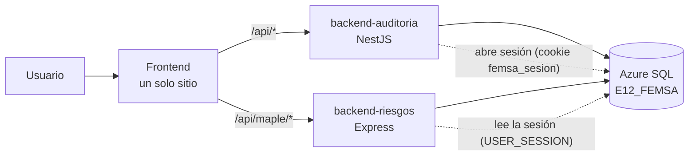

# Cómo se unen los dos proyectos

## Idea general

Un solo dominio en Vercel. El navegador habla con un solo sitio y las rutas se reparten por prefijo.

| Prefijo | Quién responde |
|---|---|
| `/` y `/auditorias/*`, `/hallazgos/*`, `/seguimiento/*`, `/ia/*` | Frontend (módulo auditoría) |
| `/maple/*` | Frontend (módulo riesgos) |
| `/api/maple/*` | `backend-riesgos` |
| `/api/*` (lo demás) | `backend-auditoria` |

## Qué aporta cada equipo

| Necesita | De quién viene |
|---|---|
| Auditorías y hallazgos | Equipo 2, lo consume Maple |
| Formularios y versiones (App Builder), riesgos (`RISK_LIBRARY`, `RISK_EVALUATION`), permisos por rol | Maple, lo consume el Equipo 2 |
| Bitácora | Equipo 2; Maple registra sus acciones en ella |
| Campana de notificaciones | Equipo 2; la bandeja de Maple es una lista de pendientes aparte |
| IA | Cada módulo conserva su proveedor (Equipo 2: OpenRouter o LM Studio; Maple: Gemini). Ver [pendientes](../pendientes.md) |

## Fases

**Fase 0 · esqueleto (hecha con este repo).** Carpetas, README de cada parte, reglas de trabajo, CI/CD, plantillas y decisiones. Sin código de producto.

**Fase 1 · frontend unido.**
1. Traer el frontend de Maple como base TypeScript (`features/riesgos`) y el del Equipo 2 como `features/auditoria`.
2. Un solo router y menú, con el login del Equipo 2.
3. Lucide como set de iconos.
4. Los backends siguen en sus repos de origen y el frontend apunta a ellos mientras tanto.
5. Primer despliegue a staging.

**Fase 2 · backends y base.**
1. Mover `backend/` del Equipo 2 a `backend-auditoria/` y pasar su código por Biome en un commit aparte.
2. Mover `FEMSA-Audit-Backend` a `backend-riesgos/` con el middleware de sesión única (ADR 0005).
3. Importar las migraciones de los dos equipos a `db/migrations/` con un orden común.
4. Despliegue de los tres proyectos desde Actions.

**Fase 3 · piezas compartidas.** Bitácora y campana unificadas, vista previa por PR, E2E sobre el sitio publicado, TypeScript completo en el frontend, y los temas de [pendientes](../pendientes.md).

## Riesgos conocidos
- Las dos APIs usan el prefijo `/api`: el reparto por `/api/maple/*` debe quedar antes que la regla general.
- Base compartida: una migración mal pensada rompe al otro equipo. Revisión cruzada obligatoria.
- Dos versiones de React Router (8 en el Equipo 2 y 7 en Maple): se fija una al unir el frontend.
- Backend en Vercel Hobby: tope de 50 imágenes por proyecto.
